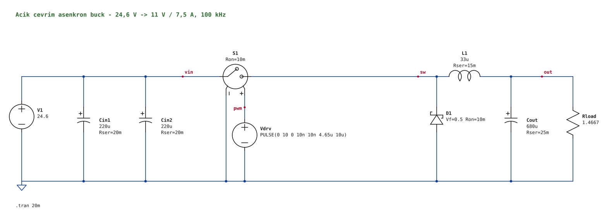

# PDU — STM32 tabanlı dijital buck

20–26 V giriş, 24,6 V nominal, 11 V / 7,5 A çıkış ve 100 kHz anahtarlama. Ana güç katı, `ANA-GUC-DEVRESI` dalındaki `6879e87` sürümünden alınan 33 µH, 1000 µF ve 470 µF + 0,22 Ω seri sönüm dalına sahip asenkron buck devresidir.

- [Yol haritası ve geçiş ölçütleri](YOL-HARITASI.md)
- [Tarihî LTspice güç katı sonuçları](buck/OPTIMIZASYON.md)
- [Güç katı parça hedefleri](buck/PARCA-HEDEFLERI.md)

Python ve PATH üzerinde ngspice ile repo kökünde `python -m control.spice` nominal açık çevrim koşusunu çalıştırır. `python buck/hesap.py` analitik güç katı hesabını üretir. LTspice ASC ve özgün LTspice betikleri referans olarak depoda bulunur.
