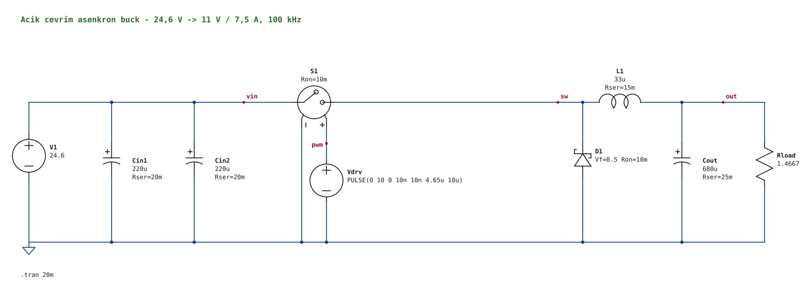

# Açık çevrim buck güç katı

20–26 V girişten (6S batarya, ana çalışma noktası 24,6 V) 11 V / 7,5 A (82,5 W) hedefleyen tek faz, asenkron, açık çevrim buck güç katı. Modül 0–7,5 A zarfında farklı uyumlu yükler içindir; T3 Gemstone O1 ve SLAMTEC RPLIDAR S2E referans yüklerdir.

**Aşama: ANA GÜÇ DEVRESİ.** Güç katının değerleri belirlendi ve LTspice'ta sınandı; parçalar için aday listesi var, kesin seçim yapılmadı. PWM, geri besleme ve soft-start henüz yok; fiziksel devre kurulmadı.

**Güncel yol:** Önce gereksinimler ve kontrol/sürücü/koruma mimarisi belirlenir; sonra kontrolcü ile güç katı adayları birlikte değerlendirilir ve parçalar kullanıcıyla kesinleştirilir. Bobin için 33 µH başlangıç hedefidir; kapalı çevrim uyumu ve gerçek sarım ölçümü henüz yoktur. Devamında gerçek değerlerle simülasyon ve tezgâh doğrulaması yapılır. [Yol haritası](YOL-HARITASI.md) bağımlılıkları ve açık işleri gösterir.

**Dondurma durumu: FROZEN (12 Kasım 2026, simülasyon dondurması).** Çıkışa paralel `Cd = 470 µF + seri Rd = 0,22 Ω` sönüm dalı eklendi. Örneklenen model setlerinde 200 ms ve ayrı bir köşede 500 ms sabit güç darbeleri sönümlü raporlandı; bütün yük, sıcaklık ve tolerans kombinasyonları doğrulanmış değildir. Gerilim sınıfları **Cout ve Cd ≥ 35 V**, **Cin ≥ 50 V** olarak belirlendi. Açık çevrim güvenli 11 V regülasyonu sağlamaz; fiziksel ölçüm yoktur ve hassas yükler bağlanmamalıdır. Kanıt ve kalan işler: [buck/OPTIMIZASYON.md](buck/OPTIMIZASYON.md) §12–13.

**Nerede kaldık, sırada ne var:** [YOL-HARITASI.md](YOL-HARITASI.md) · **Çalışma kuralları (yapay zekâ araçları dahil):** [AGENTS.md](AGENTS.md)

## Devre değerleri ve parçalar

| Eleman | Şematikteki değer | 1. sıra aday (kesin değil) | Kabul aralığı |
|---|---|---|---|
| V1 | 24,6 V | 6S batarya | 20–26 V |
| Vdrv | 100 kHz, Ton = 4,59 µs | — (sonraki aşamada sürücü + PWM) | — |
| L1 | 33 µH el sarım, DCR 7,81 mΩ (HESAP, 20 °C) | Magnetics Kool Mµ 40µ `0077536A7`, 22 sarım, 100 × 0,20 mm litz (2. sıra: satın alma, Würth 74435583300) | **33 µH** (el sarım 30,7–36,1 µH; satın alma ±%20 doğrulanmış); DCR 6,5–15 mΩ (el sarım hedefi 7,5–10 mΩ); 12 A'de L ≈ %95 |
| Cout | 1000 µF, ESR 35 mΩ (**maks. empedans, ESR varsayımı**) | Nichicon UHE1E102MHD6TO *(elektriksel R/C referansı; kesin parça ≥35 V seçilecek)* | 1000 µF ±%20, ESR ≤ 35 mΩ, **≥ 35 V** (S1 kısa devresinde 27,3–31,1 V) |
| Cd + Rd | 470 µF + seri 0,22 Ω (çıkış sönüm dalı) | — (dondurma sonrası seçilecek) | Cd: 470 µF ±%20, **≥ 35 V**; Rd: 0,22 Ω (Rd + Cd_ESR toplamı **0,15–0,60 Ω**), ≥ 0,25 W |
| Cin1, Cin2 | 2 × 1000 µF, ESR 15 mΩ | 2 × TDK B41859D7108M000 *(elektriksel R/C referansı; kesin parça ≥50 V seçilecek)* | toplam ripple akımı ≥ 4,5 A, **≥ 50 V**; örnek sıcak takma hesabı 48,0 V, gerçek kaynak ve pay doğrulanmadı |
| S1 | ideal anahtar, `Ron=5.6m` | STP100N6F7 (60 V, TO-220) | RDS(on) ≤ 12 mΩ, VDS ≥ 55 V |
| D1 | ideal diyot, `Vf=0.38 Ron=8m` | STPS40M60CT (60 V, 2 × 20 A, iki bacak paralel) | VF ≤ 0,58 V @ 7,5 A, VRRM ≥ 45 V |
| Rload | 1,467 Ω | ≥ 100 W direnç yükü | — |

Şematik ideal elemanlıdır; değerler aday listesinin başındaki parçaların veri sayfasından alınmıştır. Bu bir satın alma kararı değildir. Adayların sırası ve nedeni, doğrulama durumu ve kriterlerin nedenleri: [buck/PARCA-HEDEFLERI.md](buck/PARCA-HEDEFLERI.md). Seçim süreci ve test sonuçları: [buck/OPTIMIZASYON.md](buck/OPTIMIZASYON.md).

LTspice sonucu (24,6 V giriş, kararlı durum, 19–20 ms): Vo = 11,000 V, çıkış ripple'ı 55,7 mV t-t, bobin akımı 6,56–8,44 A. Fiziksel ölçüm yoktur.

Açık çevrim: Ton sabitken giriş veya yük değişirse çıkış 11 V'ta kalmaz; soft-start yoktur (sert kalkışta LTspice 61,4 A / 16,6 V gösterir). **Gerçek O1 veya S2E bağlanmaz.**

## LTspice'ta deneme

1. `buck/ltspice/buck_guc_kati.asc` dosyasını aç, **Run** (koşan adam simgesi) düğmesine bas.
2. `out` telinin üstüne tıkla → çıkış gerilimi. L1'in gövdesine tıkla → bobin akımı.
3. İlk ~10 ms kalkış salınımıdır; kararlı durum için 19–20 ms arasını büyüt (fareyle sürükle).
4. Grafikte iz adına (`V(out)`) **Ctrl + sol tık** → ortalama ve RMS değeri.
5. Değer değiştirmek için parçanın üstündeki değere sağ tıkla, yaz, yeniden Run. S1 ve D1 de aynı şekilde değişir (`Ron=…`, `Vf=…`).

Şematikteki tek yönerge `.tran 20m` satırıdır (simülasyon süresi); LTspice bunu şematikte ister.

Beklenen (24,6 V giriş, 19–20 ms): V(out) ortalama ≈ 11,00 V, ripple ≈ 56 mV t-t, I(L1) ≈ 6,6–8,4 A.

## Dosyalar

| Dosya | Ne işe yarar |
|---|---|
| [YOL-HARITASI.md](YOL-HARITASI.md) | Güncel durum, adımlar ve tamamlanma ölçütleri, karar günlüğü |
| [AGENTS.md](AGENTS.md) | Çalışma kuralları: neyin nasıl yapılacağı, araçlar, PCB aşaması kuralları |
| [buck/ltspice/buck_guc_kati.asc](buck/ltspice/buck_guc_kati.asc) | LTspice şematiği (çift tıkla aç, Run) |
| [buck/PARCA-HEDEFLERI.md](buck/PARCA-HEDEFLERI.md) | Aday parçalar (öncelik sırasıyla), kriterler (en az/en çok değerler) ve nedenleri, Türkiye'de bulunurluk, parça arama istemi |
| [buck/OPTIMIZASYON.md](buck/OPTIMIZASYON.md) | Yük gereksinimleri, değerlerin nasıl seçildiği, test sonuçları, açık riskler |
| [buck/hesap.py](buck/hesap.py) | Analitik hesap: ripple, akımlar, LC dinamiği, sabit güç yükü kararlılığı, kayıp ve ısı bütçesi, gerilim sınıfları (`python buck/hesap.py`) |
| [buck/dogrula.py](buck/dogrula.py) | LTspice doğrulama koşuları (`python buck/dogrula.py secilen` / `pencere` / `kararlilik` / `zarf` / `stres` / `sayisal` / `tarama` / `grafik`) |
| `buck/grafik/*.svg` | `dogrula.py grafik` ile üretilen dalga şekilleri |
| `buck/ltspice/anahtar.asy`, `diyot.asy`, `idealler.lib` | İdeal anahtar ve diyot parçaları; şematikle aynı klasörde durmalı, elle açmak gerekmez |
| [buck/ltspice/sematik_uret.py](buck/ltspice/sematik_uret.py), [asc_gorsel.py](buck/ltspice/asc_gorsel.py) | Şematiği ve yukarıdaki görseli üretir |
| [CLAUDE.md](CLAUDE.md) | Claude Code için `AGENTS.md` ve `YOL-HARITASI.md` dosyalarına yönlendirme |
