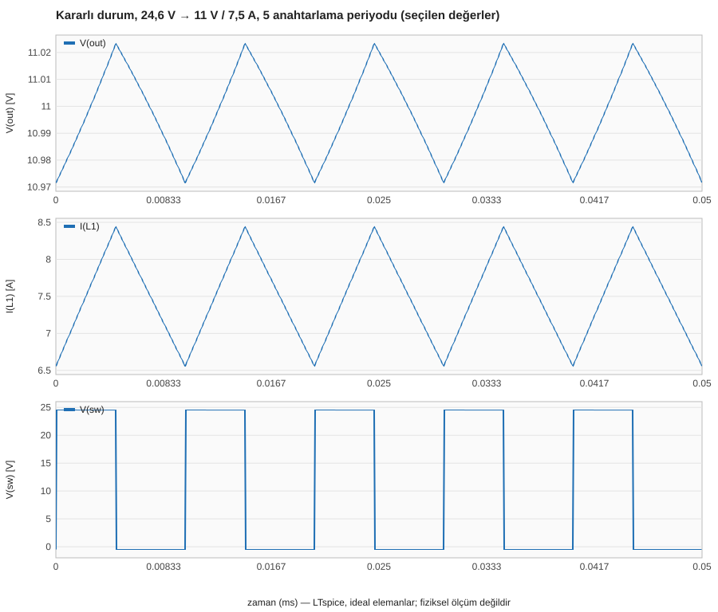
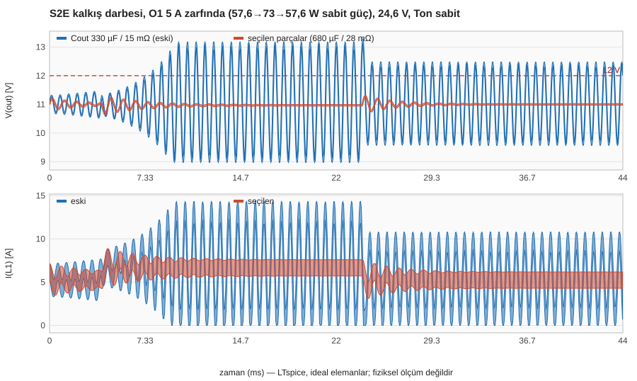
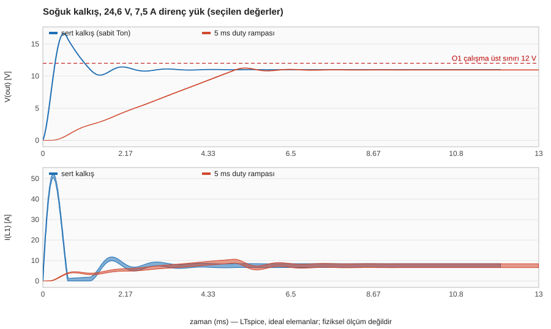

# Güç katı optimizasyonu ve doğrulama

**Tarih:** 12 Kasım 2026 · **Araç:** LTspice 26.1.1 (toplu kip), Python 3.14.5 · ideal anahtar/diyot, L/C + ESR/DCR + çıkış sönüm dalı Cd–Rd (§9.3 ve §9.4'teki ideal olmayan senaryolar ayrıca belirtilmiştir) · **Fiziksel ölçüm yok.**

**Dondurma durumu: FROZEN (simülasyon dondurması, 12 Kasım 2026):** çıkış sönüm dalı (`Cd = 470 µF + seri Rd = 0,22 Ω`) eklendi ve bütün testler koşuldu; `Cout` ve `Cd` için ≥ 35 V, `Cin` için ≥ 50 V gerilim sınıfı kabul edildi; §12.1 kapısındaki 1–12 numaralı maddelerin tamamı kullanıcı onayı dahil kapandı. Sırada parça seçimi, bobin sarımı ve ölçümler vardır (§12.2).

Etiketler: **DATASHEET** üretici belgesi · **ÇIKARIM** üretici şemasından veya eğrisinden okunan, doğrulanmamış · **TAHMİN** yayımlanmış değer yok · **HESAP** `python buck/hesap.py` · **SİM** `python buck/dogrula.py` · **ÖLÇÜM** fiziksel (bu belgede hiç yok).

Bu belge güncel kararı anlatır. Değerler parça numarasından bağımsızdır; parça kriterleri [PARCA-HEDEFLERI.md](PARCA-HEDEFLERI.md) dosyasındadır.

## 1. Karar

| Parametre | Hedef (aday parçalardan önce) | Kabul aralığı | Neden | Kanıt |
|---|---|---|---|---|
| Ana çalışma noktası | 24,6 V | 20–26 V; test 20 / 22,2 / 24,6 / 25,2 / 26 V | 6S bataryanın normal çalışma gerilimi | §5.1 |
| Çıkış | 11 V / 7,5 A | — | 11 V iki yükün aralığında (O1 5–12 V, S2E 9–28 V); yük zarfı 6,64 A, pay %13 | §2 |
| fsw | 100 kHz | sabit | Ripple ve dinamik hedefler sağlanıyor; frekansı artırmanın bedeli (anahtarlama kaybı) ideal modelle ölçülemez | §5.1 |
| Ton | 4,59 µs | — | 24,6 V / 7,5 A'de 11 V (SİM 11,000 V). İletim süresi PULSE kenarları yüzünden Ton + 10 ns'dir | §5.1 |
| L1 | 33 µH el sarım, 7,81 mΩ (@20 °C, HESAP) | **33 µH** (el sarım AL ±%8 → 30,7–36,1 µH; satın alınan ±%20 penceresi de geçer); Isat ≥ 12 A; DCR 6,5–15 mΩ (el sarım hedefi 8–10) | Akım ripple'ı %25; CCM sınırı 0,94 A tipik yükün (≈ 1,2 A) altında. 22 µH elendi (tipik yük DCM'de, çıkış 8,8 V'a düşer). 39 ve 47 µH sönüm dalıyla `pencere`'yi geçse de kullanıcı kararıyla 33 µH seçilmiştir | §4.1, §4.4 |
| Cout | 1000 µF | 1000 µF ±%20; **≥ 35 V** (kullanıcı kararı, §9.4) | Sabit güç yüküyle LC dinamiği ve ripple. S1 kısa devresinde çıkış 27,3–31,1 V'a çıktığından 35 V sınıfı kabul edildi | §4.1, §4.4, §9.4 |
| Cout ESR | 25 mΩ | **≤ 35 mΩ** @100 kHz, 20 °C (sönüm dalı varken 10–35 mΩ aralığının tamamı geçer) | Üst sınır ripple için (35 mΩ köşede 83 mV t-t). Alt sınır gereksinimini paralel Cd + Rd sönüm dalı devralır (§6, §10) | §4.2, §4.4, §6, §10 |
| Çıkış sönüm dalı (Cd + seri Rd) | **470 µF + 0,22 Ω** | Cd: 470 µF ±%20, **≥ 35 V**; ayrık Rd: **0,22 Ω** (Cd ESR'si dahil toplam dal direnci **0,15–0,60 Ω**), ≥ 0,25 W | Ana Cout ESR'sinden bağımsız CPL sönümü: bütün köşe ve sıcak ESR (10 mΩ) senaryolarında Pkritik ≥ 126 W > 82,5 W; sürekli kayıp ≈ 1,3 mW | §6, §10 |
| Cin | 2 × 1000 µF, 15 mΩ/adet | toplam ripple akımı ≥ 4,5 A; **≥ 50 V** (kullanıcı kararı, §9.4); ≥ 440 µF | 3,8 A RMS giriş ripple akımı boyutu belirler; örnek sıcak takma hesabında tepe 48,0 V, gerçek kaynak ve gerilim payı doğrulanmadı | §5.9, §9.4 |
| S1 | Ron 12 mΩ | RDS(on) ≤ 12 mΩ; VDS ≥ 55 V | İletim kaybı 0,32 W (şematik adayıyla 0,15 W) | §5.1 |
| D1 | 0,5 V + 10 mΩ | VF ≤ 0,58 V @ 7,5 A; VRRM ≥ 45 V (tercihen 60 V) | İletim kaybının üçte ikisi (şematik adayıyla 1,78 W @ 24,6 V) | §5.1 |

Geçmiş: başlangıç değerleri 22,2 V / Ton 5,14 µs / Cout 330 µF (15 mΩ) / Cin 2 × 220 µF idi. Cout önce 680 µF'a, sonra 1000 µF'a alındı; 200 ms darbe testiyle ortaya çıkan tolerans köşesi CPL salınımı için çıkışa paralel `Cd = 470 µF + Rd = 0,22 Ω` sönüm dalı eklendi (12.11.2026). L1, fsw ve çıkış hedefi baştan beri aynıdır.

**Aday parçalar ve gerilim sınıfı durumu (kesin seçim değil):** tablodaki "Hedef" sütunu aday parçalar belirlenmeden önceki başlangıç hedefleridir. Şematik değerleri: L1 33 µH el sarım / 7,81 mΩ (Magnetics Kool Mµ 40µ `0077536A7`, 22 sarım; 2. sıra satın alma: Würth 74435583300, DCR 14,52 mΩ), Cout 1000 µF / 35 mΩ, Cd 470 µF + seri Rd 0,22 Ω, Cin 2 × 1000 µF / 15 mΩ, S1 5,6 mΩ (STP100N6F7), D1 0,38 V + 8 mΩ (STPS40M60CT), Ton 4,59 µs. **Not:** mevcut listedeki 25 V Cout (Nichicon UHE1E102MHD6TO) ve 35 V Cin (TDK B41859D7108M000) adayları elektriksel R/C değerlerinin kaynağıdır; kullanıcı kararıyla minimum gerilim sınıfları **Cout/Cd ≥ 35 V** ve **Cin ≥ 50 V** olarak yükseltildiğinden, simülasyon dondurmasından sonraki parça seçimi basamağında (§12.2) bu gerilim sınıflarını sağlayan kesin parça numaraları seçilecektir ([PARCA-HEDEFLERI.md](PARCA-HEDEFLERI.md)).

Bu değerler güç katının **elektriksel temelidir**; devre açık çevrim kaldığı sürece gerçek O1/S2E bağlanamaz (§11).

**12 Kasım 2026 doğrulama ve sönüm dalı turunun özeti:**
- Ölçüm altyapısındaki iki hata giderildi: sahte ripple üreten `Vh=0` anahtar zamanlama titremesi ve yakınsamayan Ton ayarı (§5.0).
- 200 ms darbe testinde dalsız devrenin tolerans köşesinde (`L +%20`, `Cout −%20`, `ESR 15 mΩ`) 73–82,5 W sabit güç yüküyle salındığı görüldü; kullanıcı onayıyla çıkışa paralel **`Cd = 470 µF + seri Rd = 0,22 Ω` sönüm dalı** şematiğe, `hesap.py`'ye ve `dogrula.py`'ye eklendi (§6, §10).
- Test kipleri (`hesap.py`, `sayisal`, `secilen`, `pencere`, `kararlilik`, `zarf`, `stres`, `grafik`) yeni devreyle koşuldu: §6.2'deki 200 ms model setleri ve §6.1'deki ayrı 500 ms pencere köşesi 9–12 V içinde sönmüş olarak raporlandı; çıkış ripple'ı 24,6 V'ta 64,3 → 55,7 mV'a, 26 V örneklenen köşede 96,1 → 83,1 mV'a, soğuk ESR yük atma tepesi 12,13 → 11,76 V'a indi. Açık çevrim kalkış ve giriş değişimi sonuçları ayrıca sınır dışıdır.
- Kullanıcı kararıyla gerilim sınıfları **Cout ve Cd ≥ 35 V**, **Cin ≥ 50 V** olarak belirlendi; genel modül için ayrı sınır tanımlanmayıp O1/S2E uyumluluk ölçütleriyle simülasyon dondurmasına gidilmesi kararlaştırıldı (§12.1).

## 2. Gereksinimler: genel modül zarfı ve referans yükler

### 2.1 Genel modül (bu buck modülünün kendi zarfı)

Modül, tanımlı sınırlar içinde **farklı uyumlu yüklerle** çalışacak bir güç katıdır; O1 ve S2E bu zarfın içindeki iki referans yüktür (§2.2), zarfın kendisi değildir.

| Büyüklük | Zarf | Durum |
|---|---|---|
| Giriş | 20–26 V (6S); test 20 / 22,2 / 24,6 / 25,2 / 26 V; takma anı ve 28 V ayrıca stres senaryosu | tanımlı |
| Çıkış | 11 V anma; 0–7,5 A sürekli; en çok 82,5 W | tanımlı (bu modülün hedefi; başka gerilim/akım modüllerini yasaklamaz) |
| Yük tipleri | dirençli (CR), sabit akımlı (CC), sabit güçlü (CP / CPL), yük adımı (%25 ↔ %75, %50 → %100), tam yük atma, 0 A | test edildi (§6, §7) |
| 7,5 A üstü talep | Verilmek zorunda değil; **güvenle sınırlanmalıdır** | Adım 7 şartı (§11) |
| Ortam | 25 / 50 / 60 °C (HESAP, §9.2); kondansatör −10 °C Zmax (üst sınır varsayımı) | fiziksel doğrulama yok |
| Sürekli gerilim toleransı, ripple ve geçici durum sınırları | **Kullanıcı kararı (12.11.2026): şimdilik ayrı sınır tanımlanmadı**; simülasyon dondurması O1/S2E uyumluluk ölçütleriyle (9–12 V, ripple ≤ 165 mV, 200 ms darbede sönüm) yapılır | Kapandı (isteğe bağlı, tanımlanmadı) |

Genel modül için ayrı sınır tanımlanmadığından bu belgede "genel modül GEÇTİ" kararı **yoktur**; §7 tabloları karakterizasyon ve O1/S2E uyumluluk kaydı olarak tutulur. `dogrula.py` içindeki 9–12 V ve 165 mV ölçütleri O1/S2E uyumluluk ölçütüdür.

### 2.2 Referans yükler (cihaza özgü uyumluluk)

| | T3 Gemstone O1 | SLAMTEC RPLIDAR S2E |
|---|---|---|
| Besleme aralığı | 5–12 V DC konnektör, 5 A — DATASHEET | 9–28 V, tipik 12 V — DATASHEET |
| 11 V uygun mu | Evet; üst çalışma sınırına 1 V pay | Evet; alt sınıra 2 V pay |
| Çalışma akımı | Yayımlanmamış. Zarf 5 A (giriş anma akımı); tipik 10 W, boşta 4 W — TAHMİN | 12 V'ta tipik 0,20 A, en çok 0,22 A — DATASHEET |
| Kalkış | Yayımlanmamış | 12 V'ta tipik 1,2 A, en çok 1,5 A; süre verilmemiş; "düşük gerilimde kalkış daha çok akım ister" — DATASHEET |
| Ripple sınırı | Yayımlanmamış | Besleme geriliminin %3'ü (11 V'ta ±330 mV) — DATASHEET |
| Mutlak maksimum | Yayımlanmamış | Yayımlanmamış (28 V çalışma üst sınırı) |
| Giriş koruması | DC girişte TPS259470 eFuse, aşırı gerilim bölücüsü 1 MΩ / 88,7 kΩ (1,2 V eşikle ≈ 14,7 V), SMAJ16CA TVS; arkasında TPS62180 (4–15 V çalışma, 17 V mutlak) — ÇIKARIM, v0.2 şeması | Bilinmiyor |

- **O1'in 12 V üst sınırı yalnız O1'e giden port için bağlayıcıdır**; o port için bağımsız aşırı gerilim koruması Adım 7'dedir.
- Her iki cihazın girişinde DC-DC dönüştürücü var; bu yüzden testlerde **sabit güç yükü** olarak modellendi (S2E 2,64 W çalışma / 18 W kalkış, O1 4 / 10 / 55 W). Gerçek giriş dönüştürücüleri sonlu bantlıdır; ideal sabit güç modeli kötümser yöndedir.
- 11 V'ta akım: S2E 0,24 A, S2E kalkış 1,64 A, O1 zarf 5 A → sürekli zarf 5,24 A, anlık zarf 6,64 A; 7,5 A hedefinde pay %13.
- ArduPilot sayfası O1 DC girişini 5–12 V / **3 A** verir; üretici sayfaları 5 A. Zarf için 5 A kullanıldı.
- Tipik toplam yük (TAHMİN ≈ 1,2 A) bobinin CCM sınırına (0,95 A) çok yakındır; yalnız S2E veya boştaki O1 ile devre DCM'de çalışır.

Kaynaklar: [T3 Gemstone O1 ürün sayfası](https://t3gemstone.org/en/products/o1) · [O1 kart belgesi](https://docs.t3gemstone.org/en/boards/o1/introduction) · [O1 v0.2 şeması, s. 6–7](https://github.com/t3gemstone/hardware/blob/main/design/t3-gem-o1-v0_2.pdf) · [ArduPilot O1 sayfası](https://ardupilot.org/sub/docs/common-t3-gem-o1-overview.html) · [Waveshare RPLIDAR S2/S2E güç tablosu](https://www.waveshare.com/wiki/RPLIDAR_S2) (SLAMTEC datasheet tablosunun kopyası; SLAMTEC'in kendi PDF sunucusu erişim vermedi, önceki depo kaydı "datasheet S2E v1.5 s. 12" aynı değerleri veriyor) · [TPS25947](https://www.ti.com/lit/gpn/tps25947) · [TPS62180](https://www.ti.com/product/TPS62180).

## 3. Başlangıç tasarımında bulunan sorunlar (11 Kasım 2026 incelemesi)

1. **Yük modeli.** Tek doğrulama 7,5 A dirençti. Direnç LC'yi sönümler; sabit güç yükü sönümü azaltır. Eski değerlerle (33 µH / 330 µF / 15 mΩ) 57,6 W sabit güçte çıkış **2,9 V t-t sürekli salınıyor**, S2E kalkış darbesinde 8,97–13,29 V (SİM). HESAP sınırı (basitleştirilmiş): P < Vo²·C·(Rs+ESR)/L = 48 W; tam ifade §6'dadır.
2. **Hafif yük hiç incelenmemişti.** Sabit Ton'da 24,6 V girişte çıkış 0,6 A yükte 13,0 V, 0,24 A yükte 16,9 V'a çıkar (DCM; HESAP ve SİM aynı).
3. **Kalkış.** 34,7 A / 17,44 V yeniden doğrulandı (SİM). Neden: LC'ye basamak uygulanması; I tepe ≈ Vo/Z0, aşım yük sönümüne bağlı. Hafif yükte (12,6 W) aşım 21,0 V'a çıkar. L veya C seçimiyle giderilemez: taranan 9 adayın tamamında 17,2–17,6 V.
4. **Ana nokta ve test noktaları.** Hesap yalnız 20 / 22,2 / 26 V'u kapsıyordu; şematik 22,2 V'taydı.
5. **Duty.** `hesap.py` ideal D = Vo/Vin kullanıyordu; düşümlerle 24,6 V'ta Ton 4,47 değil 4,65 µs, ripple ≈ %4 daha büyük.
6. **Çıkış ripple sınırı** (%0,5 = 55 mV) cihazlardan türetilmemişti. S2E %3 ister; O1 için veri yok.
7. **Cout ESR hedefi tek taraflıydı** ("≤ 15 mΩ"). ESR düştükçe sönüm azalır.
8. **Cin simülasyonda etkisizdi:** V1 ideal kaynak olduğundan Cin akımı sıfırdır. Giriş tarafı ancak kaynak empedansıyla doğrulanabilir (§5.9).
9. Kayıp/verim hesabı yoktu.

## 4. Değerler nasıl seçildi

Ölçüt (O1/S2E uyumluluğu): referans yük senaryolarında (sabit güç) ve tolerans köşelerinde çıkışın **9–12 V** içinde kalması (S2E alt sınırı, O1 üst sınırı) ve ripple ≤ 165 mV t-t (çıkışın %1,5'i; S2E sınırı ±%3). Testlerde Ton sabittir: kontrolcünün hiç tepki vermediği kötümser durum. §4.1–§4.3 ve §4.4'ün ilk tablosu 11 Kasım 2026 koşularıdır (20 ms'lik darbe, eski ölçüm altyapısı); seçim gerekçesi olarak korunmuştur, güncel karar §4.4'ün son tablosu ve §6'dır.

### 4.1 İlk tarama: L × Cout (ESR 15 mΩ, 24,6 V)

`dogrula.py tarama`. Sütunlar: S2E kalkış darbesi (57,6 → 73 → 57,6 W) sırasında çıkış ve darbe öncesi/sırası salınım.

| L µH | Cout µF | ΔIL A | ΔVo mV | Vmin/Vmax V | 57,6 W salınım mV | 73 W salınım mV | sert kalkış A / V |
|---|---|---|---|---|---|---|---|
| 22 | 330 | 2,85 | 45,9 | 10,15/11,84 | 103 | 1623 | 41,8 / 17,6 |
| 22 | 470 | 2,85 | 45,6 | 10,63/11,31 | 43 | 47 | 48,2 / 17,6 |
| 22 | 680 | 2,85 | 45,5 | 10,72/11,25 | 43 | 44 | 56,0 / 17,4 |
| 33 | 330 (eski) | 1,90 | 29,3 | 8,97/13,29 | 2913 | 4205 | 34,9 / 17,4 |
| 33 | 470 | 1,90 | 29,2 | 10,03/12,01 | 376 | 1364 | 40,4 / 17,6 |
| 33 | 680 | 1,90 | 29,0 | 10,64/11,30 | 34 | 64 | 47,0 / 17,6 |
| 47 | 330 | 1,33 | 20,8 | 8,28/14,23 | 4047 | 5945 | 29,8 / 17,2 |
| 47 | 470 | 1,33 | 20,6 | 8,87/13,29 | 3092 | 4411 | 34,5 / 17,4 |
| 47 | 680 | 1,33 | 20,4 | 10,16/11,84 | 455 | 1628 | 40,4 / 17,5 |

- İletim verimi dokuz adayda da %96,0'dır: **L ve Cout verimi ayırt etmez**, ayırt eden sönümdür.
- Sabit güç yükü LC'yi sönümsüzleştirir. Kararlılık sınırı (HESAP, tam ifade §6): P < Vo²·(Rs+ESR)/(L/C + Rs·ESR). Cout/L oranı ve ESR büyüdükçe sınır yükselir.
- Sert kalkış aşımı tüm adaylarda 17,2–17,6 V: L/C ile giderilemez, yumuşak kalkış gerekir.

### 4.2 Cout ESR'sinin alt sınırı

33 µH / 680 µF, köşe L +%20 / Cout −%20, 57,6 W sabit güçte sürekli salınım (SİM):

| Cout ESR | 7,5 mΩ | 10 mΩ | 15 mΩ | 25 mΩ |
|---|---|---|---|---|
| Salınım t-t | 2480 mV | 2448 mV | 792 mV | 65 mV |

ESR, LC'nin sönüm direncidir. Bu yüzden "ESR ne kadar düşükse o kadar iyi" bu devrede **yanlıştır**; alt sınır konur.

### 4.3 Giriş değişimi ve daha büyük L / Cout

Ton sabit, ESR 25 mΩ (SİM):

| | A: 33 µH / 680 µF | 47 µH / 1000 µF | 68 µH / 1500 µF | 33 µH / 1000 µF |
|---|---|---|---|---|
| Kararlı çıkış, 20 / 22,2 / 24,6 / 25,2 / 26 V giriş (7,5 A) | 8,89 / 9,90 / 11,00 / 11,27 / 11,64 V | aynı | aynı | aynı |
| Giriş 24,6 → 20 V rampası (57,6 W): Vmin / Vmax | 8,68 / 11,15 V | 8,14 / 11,59 V | 7,58 / 11,98 V | 8,53 / 11,27 V |
| Giriş 22,2 → 25,2 V rampası (57,6 W): Vmax | 12,66 V | 12,94 V | 13,32 V | 12,76 V |
| Çıkış ripple'ı anma / köşe | 47 / 74 mV | 33 / 52 mV | 23 / 36 mV | 47 / 74 mV |
| Sabit Ton'da 0,6 A yükte çıkış (24,6 V) | 12,98 V | 11,52 V | 11,17 V | 12,98 V |
| O1 tipik → zarf adımı: Vmin / Vmax | 10,04 / 11,80 V | 10,08 / 11,78 V | 10,11 / 11,75 V | 10,22 / 11,64 V |
| Köşe, S2E kalkışı @zarf: salınım 57,6 / 73 W | 171 / 881 mV | 83 / 434 mV | 152 / 411 mV | 36 / 54 mV |
| Sert kalkış | 45,8 A / 17,1 V | 46,1 A / 17,1 V | 46,5 A / 17,1 V | 53,3 A / 16,9 V |

- **Giriş değişiminin kararlı etkisi L ve Cout'tan bağımsızdır:** Vo ≈ D·Vin − düşümler. Parça değeriyle düzelmez; yalnız Ton girişe göre ayarlanırsa (ileri besleme veya geri besleme) sabit kalır.
- Çok büyük L / Cout giriş geçişini kötüleştirir (LC yavaşlar): 68 µH / 1500 µF'ta 7,58–13,32 V.
- 33 µH / 1000 µF, 33 µH / 680 µF'a göre yük adımında ve köşe sönümünde daha iyidir; bedeli daha yüksek sert kalkış akımıdır (yumuşak kalkışla zaten giderilir).

### 4.4 Kabul penceresi

`dogrula.py pencere`. Her L/Cout çifti için ESR penceresinin iki kenarı ve tolerans köşeleri (L −%30/+%20, Cout −%20) koşulur.

İlk deneme (Cout = 20 × L kuralı, ESR 20–35 mΩ):

| L µH | Cout µF | ΔIL A | IL tepe köşe A | ΔVo ESR 35 mΩ: anma / köşe mV | S2E kalkışı @zarf V | O1 tipik→zarf V | köşe: S2E kalkışı @zarf V | köşe: O1 tipik→zarf V | köşe salınım 57,6 / 73 W mV | köşe yük atma sınırı V | 9–12 V ve ≤165 mV |
|---|---|---|---|---|---|---|---|---|---|---|---|
| 22 | 470 | 2.86 | 9.62 | 104 / 146 | 10.64–11.31 | 8.78–11.02 | 10.46–11.46 | 9.62–11.85 | 56 / 398 | 11.25 | KALDI |
| 33 | 680 | 1.89 | 8.91 | 66 / 98 | 10.64–11.31 | 10.03–11.80 | 10.38–11.67 | 9.78–12.06 | 130 / 717 | 11.24 | KALDI |
| 47 | 1000 | 1.33 | 8.51 | 46 / 75 | 10.70–11.31 | 10.07–11.79 | 10.67–11.24 | 9.84–11.88 | 83 / 367 | 11.23 | GEÇTİ |

- 22 µH / 470 µF: tipik yük (1,15 A) CCM sınırının (1,43 A) altında; Ton DCM'de ayarlıyken yük artınca çıkış 8,78 V'a düşer. **22 µH elendi.**
- 33 µH / 680 µF: en kötü köşede O1 tipik → zarf adımında 12,06 V. **680 µF elendi.**

Son pencere (Cout 1000 µF, ESR 15–35 mΩ, paralel sönüm dalı **Cd = 470 µF + seri Rd = 0,22 Ω**), şematikteki 1. sıra değerleriyle (el sarım L1 DCR 7,81 mΩ, Ron 5,6 mΩ, Vf 0,38 V + 8 mΩ). **12 Kasım 2026 koşusu (`dogrula.py pencere`), köşelerde Cout ve Cd −%20 (800 µF ve 376 µF), 200 ms darbe ile:**

| L µH | Cout µF | ΔIL A | IL tepe köşe A | ΔVo ESR 35 mΩ: anma / köşe mV | S2E kalkışı @zarf, 20 ms V | O1 tipik→zarf V | köşe: S2E kalkışı @zarf, 20 ms V | köşe: O1 tipik→zarf V | anma: 73 W 200 ms V, sönüm | köşe: 73 W 200 ms V, sönüm (LC periyodu başına oran) | köşe: 200 ms sonunda yavaş salınım mV t-t | köşe yük atma sınırı V | eski karar (yalnız 20 ms) | KARAR: 9–12 V, ≤165 mV, 200 ms'de sönümlü |
|---|---|---|---|---|---|---|---|---|---|---|---|---|---|---|
| 33 | 1000 | 1.88 | 8.91 | 56 / 83 | 10.77–11.20 | 10.37–11.54 | 10.72–11.25 | 10.22–11.67 | 10.77–11.20 sönmüş | 10.72–11.25 sönmüş (×1.000) | 1 | 11.20 | geçti | GEÇTİ |
| 39 | 1000 | 1.59 | 8.69 | 47 / 70 | 10.75–11.22 | 10.31–11.59 | 10.70–11.27 | 10.15–11.74 | 10.75–11.22 sönmüş | 10.70–11.27 sönmüş (×1.000) | 1 | 11.20 | geçti | GEÇTİ |
| 47 | 1000 | 1.32 | 8.49 | 39 / 58 | 10.73–11.24 | 10.24–11.65 | 10.67–11.33 | 10.06–11.84 | 10.73–11.24 sönmüş | 10.67–11.30 sönmüş (×1.000) | 1 | 11.20 | geçti | GEÇTİ |

- Karar üç şeye bakar: (1) bütün yük adımlarında ve yük atmada 9–12 V, (2) 26 V köşe ripple'ı ≤ 165 mV, (3) S2E kalkış darbesi (57,6 → 73 W) **200 ms** sürdüğünde de 9–12 V ve yavaş (LC) salınımın sönmesi.
- Sönüm dalı eklenmeden önce aynı koşuda 33 / 39 / 47 µH satırlarının üçü de köşede **kalıyordu** (33 µH: 9,91–12,05 V, 2082 mV t-t sürekli salınım; 39 / 47 µH: 12,59 / 12,86 V). **`Cd = 470 µF + Rd = 0,22 Ω` sönüm dalıyla üç satır da GEÇTİ**: 33 µH köşede 73 W 200 ms darbesi **10,72–11,25 V** içinde kalır ve darbe sonundaki yavaş salınım 1 mV t-t'dir (tamamen sönmüş).
- **Seçilen hedef L1 = 33 µH'dir** (kullanıcı kararı korunmuştur; en geniş geçici durum payını [köşe O1 adımı 10,22–11,67 V] ve en hızlı LC dinamiğini verir). Sönüm dalı sayesinde L1 toleransı +%20'ye (39,6 µH) ve hatta 47 µH +%20'ye çıksa dahi sönüm bozulmaz; el sarımda (AL ±%8 → 30,7–36,1 µH) çok geniş üretim payı oluşur.
- Sönüm artık ana `Cout`'un ESR alt sınırına veya yüksek DCR'ye muhtaç değildir (§6, §10). Ölçülebilir parça ve sarım hedef aralıkları: [PARCA-HEDEFLERI.md](PARCA-HEDEFLERI.md).

## 5. Şematik değerleriyle test sonuçları (SİM)

Şematik değerleri ([PARCA-HEDEFLERI.md](PARCA-HEDEFLERI.md)): L 33 µH / 7,81 mΩ (el sarım, HESAP) · Cout 1000 µF / 35 mΩ (maks. empedans, ESR varsayımı) · **Cd 470 µF + seri Rd 0,22 Ω** · Cin 2 × 1000 µF / 15 mΩ · Ron 5,6 mΩ · Vf 0,38 V + 8 mΩ · 100 kHz. Tablolar `python buck/dogrula.py secilen` çıktısıdır (12.11.2026, çıkış kodu 0).

### 5.0 Ölçüm altyapısı: bulunan hatalar ve düzeltme (`dogrula.py sayisal`)

Düzeltme öncesi tablolarda anahtar zamanlama titremesi yüzünden ripple HESAP'tan %5–9 yüksek görünüyordu. Neden deneyle ayrıldı (sönüm dalı dahil güncel devreyle):

| Anahtar modeli | iletim süresi ort. ns (Ton 4589 ns) | titreme t-t ns | titreme std ps | ΔVo mV t-t | dVo/dTon mV/ns (beklenen Vin/T = 2,46) | doğrudan sapma maks mV (Ton 4580–4600 ns) | ΔVo aralığı mV (aynı tarama) |
|---|---|---|---|---|---|---|---|
| idealler.lib (Vh=0, sert geçiş) | 4597.518 | 2.145 | 1013 | 60.6 | 2.535 | 4.08 | 56.2–60.8 |
| test modeli (Vh=−0,5, yumuşak geçiş) | 4598.981 | 0.000 | 0 | 55.7 | 2.475 | 0.00 | 55.7–55.7 |

- **Kök neden:** `idealler.lib` anahtarı `Vh=0` (sert geçiş) ile tanımlıdır. LTspice, 10 ns'lik PULSE kenarının ortasındaki geçiş anını zaman adımına göre çözer; iletim süresi periyottan periyoda ≈ 2 ns oynar (std ≈ 1 ns). Bu titreme LC'yi uyarır, 1 ms'lik pencerede tepe-tepe değeri büyütür ve Vo(Ton) eğrisini basamaklı yapar (doğrudan sapma 4,1 mV). `Vh=−0,5` (yumuşak geçiş) ile titreme **sıfırdır**.
- Denenip **neden olmadığı** görülenler: `plotwinsize=0` (sıkıştırma) etkisiz; `maxstep` 100 / 50 / 20 ns aynı sonucu verir (5 ns'de titreme sürer); bobinin varsayılan paralel direnci etkisiz; diyot `Epsilon` etkisiz. Ölçüm penceresini 15–16 ms'den 19–20 ms'ye almak sonucu değiştirir ama bunun nedeni pencere değil, `tstop` değişince zaman adımı diziliminin değişmesidir.
- **Düzeltme:** test netlistleri, `idealler.lib` ile aynı değerleri taşıyan ama anahtarı `Vh=-0.5` olan bir modeli netliste gömer. `idealler.lib`, `anahtar.asy`, `diyot.asy` ve ana şematik **değişmedi**. Ana şematiğin LTspice'taki kendi koşusu (`.tran 20m`, 19–20 ms) Vo = 11,000 V ve ΔVo = 55,7 mV t-t verir.
- **Ton ayarı:** kökü iki yandan sarar, ölçüt çıkış gerilimi cinsindendir (1 mV eşdeğeri veya akımın %0,5'i), Ton 9 basamakla yazılır, bobin başlangıç akımı vadi değeridir, **yakınsamazsa koşu hata ile durur**.

Beş girişte ripple, hesap (`ESR || Rd || Rload`) ve iki modelle:

| Vin V | Ton µs | HESAP ΔVo mV | yumuşak: ΔVo mV | yumuşak: Vo V | sert: ΔVo mV | sert: Vo V |
|---|---|---|---|---|---|---|
| 20 | 5.6271 | 45.0 | 45.0 | 11.0000 | 45.5 | 10.9999 |
| 22.2 | 5.0783 | 50.6 | 50.6 | 11.0000 | 55.2 | 10.9959 |
| 24.6 | 4.5898 | 55.7 | 55.7 | 11.0000 | 60.8 | 11.0009 |
| 25.2 | 4.4820 | 56.8 | 56.8 | 11.0000 | 57.4 | 10.9999 |
| 26 | 4.3459 | 58.2 | 58.2 | 11.0000 | 63.5 | 11.0009 |

Yakınsayan Ton değerleri [µs] (25 nokta, DCM dahil; hepsi yakınsadı):

| Vin V \ yük A | 0,24 | 0,6 | 1,15 | 2,5 | 7,5 |
|---|---|---|---|---|---|
| 20 | 3.1249 | 4.9467 | 5.5821 | 5.5917 | 5.6271 |
| 22.2 | 2.6598 | 4.2113 | 5.0373 | 5.0460 | 5.0783 |
| 24.6 | 2.2935 | 3.6321 | 4.5524 | 4.5604 | 4.5898 |
| 25.2 | 2.2177 | 3.5123 | 4.4454 | 4.4532 | 4.4820 |
| 26 | 2.1244 | 3.3647 | 4.3103 | 4.3179 | 4.3459 |

### 5.1 Kararlı durum, 7,5 A direnç yük, Ton her girişte 11 V'a ayarlı (ideal regülasyon varsayımı)

| Vin V | Ton µs | Vo V | ΔVo mV | IL A | S1 rms A | D1 ort A | Cout rms A | P S1 W | P D1 W | P L1 W | P toplam W | η iletim % |
|---|---|---|---|---|---|---|---|---|---|---|---|---|
| 20 | 5.627 | 11.000 | 45.0 | 6.74–8.26 | 5.64 | 3.27 | 0.37 | 0.18 | 1.44 | 0.44 | 2.06 | 97.56 |
| 22.2 | 5.078 | 11.000 | 50.6 | 6.64–8.36 | 5.36 | 3.68 | 0.42 | 0.16 | 1.62 | 0.44 | 2.23 | 97.37 |
| 24.6 | 4.590 | 11.000 | 55.7 | 6.56–8.44 | 5.10 | 4.05 | 0.46 | 0.15 | 1.78 | 0.44 | 2.38 | 97.20 |
| 25.2 | 4.482 | 11.000 | 56.8 | 6.54–8.46 | 5.04 | 4.13 | 0.47 | 0.14 | 1.82 | 0.44 | 2.41 | 97.16 |
| 26 | 4.346 | 11.000 | 58.2 | 6.52–8.48 | 4.96 | 4.23 | 0.48 | 0.14 | 1.86 | 0.44 | 2.45 | 97.11 |

Verim yalnız iletim kaybıdır (`Rd` üzerindeki ≈ 1,3 mW dahil); anahtarlama, çekirdek ve kondansatör kayıplarıyla kestirim §9.1'dedir. Ripple akımının %14'ü `0,22 Ω` sönüm dalından geçtiğinden `Cout` RMS akımı (0,46 A) ve çıkış ripple'ı (55,7 mV) dalsız devreye (0,53 A / 64,3 mV) göre düşmüştür; HESAP ile 0,0 mV içinde uyuşur.



### 5.2 Kararlı durum, referans yük senaryoları, 24,6 V, Ton 11 V'a ayarlı (sabit güç yükü)

| Senaryo | P W | I@11V A | Ton µs | Kip | Vo V | ΔVo mV | IL tepe A | η iletim % |
|---|---|---|---|---|---|---|---|---|
| yalnız S2E çalışma | 2.64 | 0.24 | 2.293 | DCM | 10.995 | 29.4 | 0.95 | 98.0 |
| yalnız O1 boşta (tahmin) | 4.00 | 0.36 | 2.825 | DCM | 10.992 | 36.3 | 1.17 | 97.9 |
| yalnız O1 tipik (tahmin) | 10.00 | 0.91 | 4.473 | DCM | 10.984 | 56.7 | 1.85 | 97.9 |
| O1 boşta + S2E | 6.64 | 0.60 | 3.643 | DCM | 10.987 | 46.6 | 1.51 | 97.9 |
| O1 tipik + S2E | 12.64 | 1.15 | 4.552 | CCM | 11.000 | 56.9 | 2.09 | 97.9 |
| O1 tipik + S2E kalkış | 28.00 | 2.55 | 4.561 | CCM | 11.000 | 57.1 | 3.49 | 97.8 |
| yalnız O1 zarf 5 A | 55.00 | 5.00 | 4.575 | CCM | 11.000 | 57.6 | 5.94 | 97.5 |
| O1 zarf + S2E | 57.64 | 5.24 | 4.576 | CCM | 11.000 | 57.6 | 6.18 | 97.5 |
| O1 zarf + S2E kalkış | 73.00 | 6.64 | 4.585 | CCM | 11.000 | 57.9 | 7.58 | 97.3 |

Ripple her senaryoda S2E sınırının (±330 mV) çok altında. DCM satırlarında Vo'nun 11,000 V'tan 5–16 mV sapması, 16 ms'lik koşuda çıkışın tam oturmamasındandır (hafif yükte zaman sabiti onlarca ms); Ton kelepçeli ayardan gelir ve doğrudur. DCM'de gereken Ton yükle 2,3–4,5 µs arasında değişir: geri besleme bu aralığı kapsamalıdır.

### 5.3 Açık çevrim: Ton sabit (24,6 V / 7,5 A'ya ayarlı), giriş ve yük değişince kararlı çıkış [V]

| Vin V \ yük A@11V | 0.24 | 0.6 | 1.15 | 2.5 | 5.24 | 7.5 |
|---|---|---|---|---|---|---|
| 20 | 13.62 | 10.48 | 8.98 | 8.96 | 8.93 | 8.91 |
| 22.2 | 15.12 | 11.64 | 9.99 | 9.97 | 9.94 | 9.91 |
| 24.6 | 16.76 | 12.90 | 11.09 | 11.07 | 11.03 | 11.00 |
| 25.2 | 17.17 | 13.22 | 11.37 | 11.35 | 11.31 | 11.27 |
| 26 | 17.72 | 13.64 | 11.74 | 11.72 | 11.67 | 11.64 |

O1'in 5–12 V aralığı yalnız 24,6 V civarında ve yük CCM'deyken sağlanır. **Açık çevrim hiçbir L/C değeriyle regülasyon sağlamaz**; bu bir güç katı hatası değil, bilinen açık çevrim sınırıdır ve geri beslemeyle (Adım 6) kapanır. Yüksüz çalışmada çıkış giriş gerilimine tırmanır.

### 5.4 Yük adımları, 24,6 V, Ton sabit (kontrolcü tepki vermiyor = kötümser sınır), darbe 200 ms

| Adım (200 ms) | P W | Vmin V | Vmax V | ara kararlı V | ara salınım mV | son kararlı V | son salınım mV | IL tepe A | yavaş salınım |
|---|---|---|---|---|---|---|---|---|---|
| S2E kalkışı, O1 tipik | 12.6→28.0 | 10.78 | 11.20 | 10.98 | 57 | 11.00 | 57 | 4.4 | sönmüş |
| O1 tipik→zarf→tipik, S2E çalışıyor | 12.6→57.6 | 10.38 | 11.53 | 10.94 | 58 | 11.00 | 57 | 9.0 | sönmüş |
| S2E kalkışı, O1 zarf | 57.6→73.0 | 10.77 | 11.21 | 10.98 | 58 | 11.00 | 58 | 8.6 | sönmüş |
| O1 zarf→boşta→zarf, S2E çalışıyor | 57.6→6.6 | 10.45 | 16.07 | 16.04 | 37 | 11.00 | 58 | 8.9 | sönmüş |

İlk üç adımda çıkış kontrolcü olmadan bile 9–12 V içinde kalır (dalsız devreye göre sapma ≈ 50–140 mV daha dardır) ve salınım söner. Son satır DCM yükselmesidir (§5.3): 200 ms'de 16,07 V'a çıkar ve yalnız geri beslemeyle giderilir.



### 5.5 Yük atma, ideal kontrolcü sınırı (yük düştüğü anda duty = 0; en iyi durum)

| Vin V | 73→6,6 W Vtepe V | 82,5→2,6 W Vtepe V |
|---|---|---|
| 20 | 11.197 | 11.234 |
| 22.2 | 11.200 | 11.237 |
| 24.6 | 11.202 | 11.240 |
| 25.2 | 11.203 | 11.240 |
| 26 | 11.204 | 11.241 |

Bobindeki enerji `Cout` ve `Cd + Rd` dalına boşaldığında oluşan tepe budur (dalsız devredeki 11,28 V'tan 11,24 V'a düşer). Kontrol gecikmesinin ve soğuk ESR'nin etkisi §7.3'tedir.

### 5.6 Soğuk kalkış

| Vin V | Yük | sert: IL tepe A | sert: Vo tepe V | 5 ms duty rampası: IL tepe A | 5 ms duty rampası: Vo tepe V |
|---|---|---|---|---|---|
| 20 | 7,5 A direnç | 61.3 | 16.64 | 11.5 | 11.34 |
| 22.2 | 7,5 A direnç | 61.4 | 16.63 | 11.6 | 11.34 |
| 24.6 | 7,5 A direnç | 61.4 | 16.63 | 11.7 | 11.34 |
| 25.2 | 7,5 A direnç | 61.4 | 16.63 | 11.7 | 11.34 |
| 26 | 7,5 A direnç | 61.5 | 16.62 | 11.8 | 11.34 |
| 24.6 | O1 tipik + S2E (12,6 W) | 63.1 | 18.07 | 8.0 | 11.39 |

`Cd` sönüm dalı toplam çıkış kapasitesini artırdığı için sert kalkış tepe akımı 53,4 → 61,5 A'e çıkar, tepe gerilim sönüm sayesinde 17,01 → 16,62 V'a (12,6 W'ta 18,81 → 18,07 V'a) iner; sert kalkış hâlâ O1 girişini zorlar ve doğrusal olmayan bobini doyuma iter (`L/L0 ≈ %53` @61 A). 5 ms'lik duty rampasıyla (yumuşak kalkış varsayımı, Adım 5) bobin akımı 11,8 A ≤ 12 A ve çıkış 11,39 V ≤ 12 V içinde kalır.



### 5.7 Giriş değişimi, Ton sabit, O1 zarf + S2E (57,6 W)

| Vin V (1 ms rampa) | Vmin V | Vmax V | ara kararlı V |
|---|---|---|---|
| 24.6→20→24.6 | 8.33 | 11.50 | 8.87 |
| 24.6→26→24.6 | 10.82 | 11.82 | 11.65 |
| 22.2→25.2→22.2 | 10.62 | 12.90 | 12.53 |

Çıkış girişi oransal izler (ΔVo ≈ D·ΔVin). 20 V'ta S2E'nin 9 V alt sınırının altına, batarya dolarken O1'in 12 V sınırının üstüne çıkar. L/Cout ile düzelmez (§4.3); bilinen açık çevrim sınırıdır.

### 5.8 Tolerans köşeleri (L −%30/+%20, Cout ve Cd ±%20, ESR 15/35 mΩ), 7,5 A; zarf adımı 200 ms

| Köşe | Vin V | ΔVo mV | IL tepe A | zarf adım (200 ms) Vmin/Vmax | 73 W darbe sonu t-t mV | yavaş salınım | yük atma sınırı V | sert kalkış A/V | rampalı kalkış A/V |
|---|---|---|---|---|---|---|---|---|---|
| anma | 24.6 | 55.7 | 8.44 | 10.77/11.21 | 58 | sönmüş | 11.20 | 61.4/16.6 | 11.7/11.34 |
| ripple en kötü: L−, C−, ESR 35 mΩ | 26 | 83.1 | 8.91 | 10.77/11.21 | 86 | sönmüş | 11.21 | 65.0/16.5 | 11.5/11.26 |
| sönüm en zayıf: L+, C−, ESR 15 mΩ | 24.6 | 21.8 | 8.28 | 10.72/11.25 | 22 | sönmüş | 11.11 | 54.1/17.4 | 10.9/11.35 |
| Z0 en düşük: L−, C+, ESR 15 mΩ | 26 | 39.1 | 8.91 | 10.82/11.16 | 40 | sönmüş | 11.10 | 79.6/16.8 | 12.8/11.30 |

L −%30, −%20 toleransı ve tepe akımdaki endüktans düşümünü birlikte kapsar. **Dört köşenin tamamı GEÇER:** daha önce 9,91–12,05 V ve 2140 mV t-t sürekli salınımla kalan "sönüm en zayıf" köşe, `Cd = 376 µF (−%20) + Rd = 0,22 Ω` ile **10,72/11,25 V** aralığında ve **sönmüş** olarak kapanır (darbe sonu 22 mV t-t yalnız 100 kHz anahtarlama ripple'ıdır). `Z0 en düşük` köşede 5 ms rampa kalkış akımı 12,8 A'dir; Adım 5'te ≥ 6 ms rampa veya akım sınırlamalı kalkışla ≤ 12 A tutulur.

### 5.9 Giriş tarafı, batarya+kablo modeli (VARSAYIM 40 mΩ + 1 µH/10 mΩ), 7,5 A

| Batarya V | Vo V | ΔVin mV t-t | Cin toplam rms A | Cin ESR kaybı W |
|---|---|---|---|---|
| 20 | 10.870 | 69 | 3.69 | 0.10 |
| 24.6 | 10.908 | 71 | 3.73 | 0.10 |
| 26 | 10.917 | 71 | 3.71 | 0.10 |

Batarya 26 V sıcak takma (anahtar kapalı): V(vin) tepe 26.0 V, batarya akımı tepe 359 A

Ton ideal kaynağa göre ayarlıdır; kaynak direnci girişi ≈ 0,3 V düşürdüğü için açık çevrim çıkış 10,87–10,92 V'ta kalır (koşu bunu uyarı olarak yazar). Değerler tahmini kaynak empedansına bağlıdır; farklı kaynak R/L değerleri için sıcak takma süpürmesi §9.4'tedir. İki TDK kondansatörün toplam ripple akımı anma değeri 6,5 A'dir.

## 6. Sabit güç yükü ile kararlılık (HESAP + SİM)

`python buck/dogrula.py kararlilik` ve `python buck/hesap.py` §6. Ton sabit (açık çevrim), 24,6 V; şematikte `Cd = 470 µF + seri Rd = 0,22 Ω` sönüm dalı vardır (`C −%20` köşelerinde `Cd` de −%20 = 376 µF).

### 6.1 Darbe süresinin etkisi (1 ms – 500 ms)

Pencere köşesi: L 39,6 µH, Cout 800 µF, ESR 15 mΩ, Cd 376 µF + Rd 0,22 Ω, DCR 7,81 mΩ; 57,64 → 73 → 57,64 W.

| Darbe ms | Vmin V | Vmax V | darbe sonu t-t mV | yavaş salınım, son iki LC periyodu mV | oran | sönüm | 9–12 V | karar |
|---|---|---|---|---|---|---|---|---|
| 1 | 10.72 | 11.33 | 389 | — | — | kısa | içinde | GEÇTİ |
| 5 | 10.72 | 11.27 | 231 | 207 → 140 | 0.679 | sönüyor | içinde | GEÇTİ |
| 20 | 10.72 | 11.25 | 25 | 4 → 3 | 0.754 | sönmüş | içinde | GEÇTİ |
| 50 | 10.72 | 11.25 | 22 | 1 → 1 | 1.000 | sönmüş | içinde | GEÇTİ |
| 200 | 10.72 | 11.25 | 22 | 1 → 1 | 1.000 | sönmüş | içinde | GEÇTİ |
| 500 | 10.72 | 11.25 | 22 | 1 → 1 | 1.000 | sönmüş | içinde | GEÇTİ |

HESAP (aynı köşe, 73 W): denge 10.979 V, Pkritik 146.0 W, sönüm +287.2 1/s → LC periyodu başına oran 0.725, zaman sabiti 3 ms

- "oran": yavaş (≈ 0,9 kHz) salınımın art arda iki LC periyodundaki tepe-tepe değerlerinin oranı. Çıkış 4,8 kHz RC'den geçirilerek ölçülür (anahtarlama ripple'ı ayrılır). Sönüm sınıfları: sönmüş (< 20 mV) · sönüyor (oran < 0,98) · sürekli salınım (0,98–1,02) · büyüyor (> 1,02). Son ikisi kabul edilmez.
- Dalsız devrede aynı köşe 200 ms'de 9,91–12,05 V'a, 500 ms'de 9,64–12,32 V sınır çevrimine çıkıyordu (`Pkritik = 72 W`, sönüm −5,1 1/s). **Sönüm dalıyla sönüm +287 1/s'ye (τ ≈ 3 ms) döner**: 5 ms'de salınım periyot başına `×0,679` ile hızla söner (HESAP: `×0,725`), 20 ms'de 3 mV'a düşer ve 50–500 ms boyunca çıkış **10,72–11,25 V** aralığında tamamen sönmüş kalır.

### 6.2 Model setleri × yük (200 ms darbe)

| Model seti | P W | HESAP Pkritik W | HESAP sönüm 1/s | HESAP oran/periyot | SİM oran/periyot | SİM sönüm | Vmin V | Vmax V | 200 ms sonunda yavaş salınım mV | HESAP–SİM aynı yönde | 9–12 V | karar |
|---|---|---|---|---|---|---|---|---|---|---|---|---|
| anma (şematik) | 57.6→73.0 | 257 | +602 | 0.503 | 1.000 | sönmüş | 10.77 | 11.21 | 2 | evet | içinde | GEÇTİ |
| anma (şematik) | 41.2→82.5 | 256 | +573 | 0.520 | 1.000 | sönmüş | 10.42 | 11.50 | 2 | evet | içinde | GEÇTİ |
| anma (şematik) | 20.6→61.9 | 254 | +633 | 0.486 | 1.000 | sönmüş | 10.43 | 11.49 | 2 | evet | içinde | GEÇTİ |
| pencere köşesi: L+%20, C−%20, ESR 15 mΩ | 57.6→73.0 | 146 | +287 | 0.725 | 1.000 | sönmüş | 10.72 | 11.25 | 1 | evet | içinde | GEÇTİ |
| pencere köşesi: L+%20, C−%20, ESR 15 mΩ | 41.2→82.5 | 145 | +250 | 0.756 | 1.000 | sönmüş | 10.26 | 11.64 | 1 | evet | içinde | GEÇTİ |
| pencere köşesi: L+%20, C−%20, ESR 15 mΩ | 20.6→61.9 | 145 | +327 | 0.693 | 1.000 | sönmüş | 10.28 | 11.63 | 1 | evet | içinde | GEÇTİ |
| el sarım: L+%8, C−%20, ESR 15 mΩ | 57.6→73.0 | 161 | +348 | 0.692 | 1.000 | sönmüş | 10.74 | 11.24 | 1 | evet | içinde | GEÇTİ |
| el sarım: L+%8, C−%20, ESR 15 mΩ | 41.2→82.5 | 160 | +310 | 0.720 | 1.000 | sönmüş | 10.30 | 11.61 | 1 | evet | içinde | GEÇTİ |
| el sarım: L+%8, C−%20, ESR 15 mΩ | 20.6→61.9 | 159 | +388 | 0.663 | 1.000 | sönmüş | 10.32 | 11.59 | 1 | evet | içinde | GEÇTİ |
| en az sönüm: köşe + DCR 6,5, Ron 4,7, Rd 4 mΩ | 57.6→73.0 | 134 | +237 | 0.767 | 1.000 | sönmüş | 10.72 | 11.26 | 1 | evet | içinde | GEÇTİ |
| en az sönüm: köşe + DCR 6,5, Ron 4,7, Rd 4 mΩ | 41.2→82.5 | 134 | +200 | 0.799 | 1.000 | sönmüş | 10.26 | 11.65 | 1 | evet | içinde | GEÇTİ |
| en az sönüm: köşe + DCR 6,5, Ron 4,7, Rd 4 mΩ | 20.6→61.9 | 133 | +278 | 0.733 | 1.000 | sönmüş | 10.28 | 11.64 | 1 | evet | içinde | GEÇTİ |
| en az sönüm sıcak: köşe + ESR 10 mΩ (TAHMİN), Rd 6 mΩ | 57.6→73.0 | 136 | +247 | 0.758 | 1.000 | sönmüş | 10.72 | 11.25 | 1 | evet | içinde | GEÇTİ |
| en az sönüm sıcak: köşe + ESR 10 mΩ (TAHMİN), Rd 6 mΩ | 41.2→82.5 | 135 | +210 | 0.791 | 1.000 | sönmüş | 10.26 | 11.65 | 1 | evet | içinde | GEÇTİ |
| en az sönüm sıcak: köşe + ESR 10 mΩ (TAHMİN), Rd 6 mΩ | 20.6→61.9 | 135 | +287 | 0.725 | 1.000 | sönmüş | 10.28 | 11.63 | 1 | evet | içinde | GEÇTİ |
| anma L/C, ESR 15 mΩ, Rd 4 mΩ | 57.6→73.0 | 199 | +407 | 0.629 | 1.000 | sönmüş | 10.77 | 11.21 | 1 | evet | içinde | GEÇTİ |
| anma L/C, ESR 15 mΩ, Rd 4 mΩ | 41.2→82.5 | 198 | +377 | 0.650 | 1.000 | sönmüş | 10.41 | 11.52 | 1 | evet | içinde | GEÇTİ |
| anma L/C, ESR 15 mΩ, Rd 4 mΩ | 20.6→61.9 | 198 | +440 | 0.606 | 1.000 | sönmüş | 10.42 | 11.51 | 1 | evet | içinde | GEÇTİ |
| anma L/C, ESR 10 mΩ (TAHMİN), Rd 4 mΩ | 57.6→73.0 | 187 | +368 | 0.657 | 1.000 | sönmüş | 10.78 | 11.20 | 1 | evet | içinde | GEÇTİ |
| anma L/C, ESR 10 mΩ (TAHMİN), Rd 4 mΩ | 41.2→82.5 | 186 | '+338'.replace("'","") | 0.680 | 1.000 | sönmüş | 10.40 | 11.52 | 1 | evet | içinde | GEÇTİ |
| anma L/C, ESR 10 mΩ (TAHMİN), Rd 4 mΩ | 41.2→82.5 | 186 | +338 | 0.680 | 1.000 | sönmüş | 10.40 | 11.52 | 1 | evet | içinde | GEÇTİ |
| anma L/C, ESR 10 mΩ (TAHMİN), Rd 4 mΩ | 20.6→61.9 | 185 | +401 | 0.633 | 1.000 | sönmüş | 10.42 | 11.51 | 1 | evet | içinde | GEÇTİ |
| en çok kayıp (sıcak bakır/RDS, VF azami) | 57.6→73.0 | 262 | +627 | 0.489 | 1.000 | sönmüş | 10.77 | 11.21 | 2 | evet | içinde | GEÇTİ |
| en çok kayıp (sıcak bakır/RDS, VF azami) | 41.2→82.5 | 261 | +598 | 0.506 | 1.000 | sönmüş | 10.42 | 11.50 | 2 | evet | içinde | GEÇTİ |
| en çok kayıp (sıcak bakır/RDS, VF azami) | 20.6→61.9 | 259 | +658 | 0.472 | 1.000 | sönmüş | 10.43 | 11.49 | 2 | evet | içinde | GEÇTİ |
| soğuk: ESR 120 mΩ (Zmax −10 °C, üst sınır) | 57.6→73.0 | 430 | +1247 | 0.241 | 1.000 | sönmüş | 10.74 | 11.24 | 6 | evet | içinde | GEÇTİ |
| soğuk: ESR 120 mΩ (Zmax −10 °C, üst sınır) | 41.2→82.5 | 428 | +1224 | 0.248 | 1.000 | sönmüş | 10.41 | 11.50 | 6 | evet | içinde | GEÇTİ |
| soğuk: ESR 120 mΩ (Zmax −10 °C, üst sınır) | 20.6→61.9 | 426 | +1272 | 0.235 | 1.000 | sönmüş | 10.43 | 11.49 | 6 | evet | içinde | GEÇTİ |

Tam 3. derece durum uzayı ifadesi ve geçerlilik sınırı (`hesap.py` `cpl()`): durumlar `[iL, vCout, vCd]`, seri L + Rs (Rs = DCR + D·Ron + (1−D)·Rd), paralel kol Cout + ESR, paralel sönüm dalı Cd + Rd, yük i = P/v; denge noktası vo = vth − Rs·P/vo (`Cd` DC'yi keser).

```
6) Sabit güç yükü (CPL) ile açık çevrim kararlılığı — 3. derece tam ifade (şematik Cd=470 µF + Rd=0,22 Ω dahil)
   Durum uzayı [iL, vCout, vCd], gerçek denge noktası; C−%20 setlerinde Cd de −%20 (376 µF); duty 57,64 W'ta 11 V'a ayarlı, 24,6 V
   sönüm = −max Re(s) > 0: salınım söner (zaman sabiti 1/sönüm); sönüm < 0: BÜYÜR. Geçerlilik: cpl() açıklaması.
   model seti                                               Rs mΩ  Pkritik W | 57,64 W: sönüm 1/s | 73 W: Vo V  sönüm 1/s  τ ms   | 82,5 W: sönüm 1/s  τ ms
   anma (şematik)                                            14.7    256.6   |    +646.9          | 10.979    +602.2       2   |    +574.1       2
   pencere köşesi: L+%20, C−%20, ESR 15 mΩ                   14.7    146.0   |    +345.1          | 10.979    +287.2       3   |    +251.0       4
   el sarım: L+%8, C−%20, ESR 15 mΩ                          14.7    160.6   |    +405.9          | 10.979    +347.9       3   |    +311.6       3
   en az sönüm: köşe + DCR 6,5, Ron 4,7, Rd 4 mΩ             10.8    134.3   |    +294.9          | 10.985    +237.3       4   |    +201.3       5
   en az sönüm sıcak: köşe + ESR 10 mΩ (TAHMİN), Rd 6 mΩ     14.1    136.0   |    +305.4          | 10.980    +247.2       4   |    +210.8       5
   anma L/C, ESR 15 mΩ, Rd 4 mΩ                              12.1    199.1   |    +454.0          | 10.983    +407.4       2   |    +378.2       3
   anma L/C, ESR 10 mΩ (TAHMİN), Rd 4 mΩ                     12.1    186.8   |    +415.3          | 10.983    +368.1       3   |    +338.7       3
   en çok kayıp (sıcak bakır/RDS, VF azami)                  16.3    262.0   |    +672.0          | 10.977    +627.2       2   |    +599.1       2
   soğuk: ESR 120 mΩ (Zmax −10 °C, üst sınır)                14.7    430.1   |   +1282.3          | 10.979   +1247.3       1   |   +1225.1       1
   ↑ = büyüyen salınımın zaman sabiti. Dalsız basitleştirilmiş sınır (Rs·ESR ve Cd-Rd yok, Vo = 11 V): anma 182 W, köşe 73 W.
   Sönüm dalıyla (470 µF + 0,22 Ω) bütün model setlerinde Pkritik ≥ 126 W > 82,5 W modül zarfı.
```

- **9 model seti × 3 sabit güç adımı = 27 satırın tamamında HESAP ve SİM uyuşur ve tamamı GEÇER** (`10,26–11,65 V`, darbe sonunda yavaş salınım ≤ 6 mV t-t).
- En sert kombinasyonda bile (`L +%20`, `Cout −%20`, `Cd −%20`, `DCR 6,5 mΩ`, `Ron 4,7 mΩ`, `Rd_diyot 4 mΩ`, sıcak `Cout ESR 10 mΩ`) kritik güç `Pkritik = 126 W`'tır (82,5 W modül zarfının **1,53 katı**); sönüm zaman sabiti ≤ 5 ms'dir.
- Böylece `Cout`'un ölçülmemiş alt ESR sınırı artık bir kararlılık riski oluşturmaz; `Cout` seçimi yalnızca üst empedans/ESR (≤ 35 mΩ @100 kHz) ve ripple akımı ile sınırlanır.

## 7. Genel modül zarfı (SİM)

`python buck/dogrula.py zarf`. Genel modül için ayrı sınır tanımlanmadığından genel GEÇTİ/KALDI kararı yoktur; son sütun O1/S2E uyumluluğudur.

### 7.1 Kararlı durum, 0,24 A – 7,5 A, beş giriş (Ton her noktada 11 V'a ayarlı)

| Vin V | Yük | Ton µs | Kip | Vo V | kayma mV/ms | ΔVo mV | IL tepe A | iletim kaybı W |
|---|---|---|---|---|---|---|---|---|
| 20 | düşük 0,24 A | 3.125 | DCM | 10.997 | -0.2 | 26.4 | 0.85 | 0.04 |
| 20 | %25 | 5.587 | CCM | 11.000 | -0.0 | 45.7 | 2.64 | 0.37 |
| 20 | %50 | 5.601 | CCM | 11.000 | +0.0 | 45.5 | 4.51 | 0.84 |
| 20 | %75 | 5.614 | CCM | 11.000 | +0.0 | 45.2 | 6.39 | 1.40 |
| 20 | %100 | 5.627 | CCM | 11.000 | +0.0 | 45.0 | 8.26 | 2.06 |
| 22.2 | düşük 0,24 A | 2.660 | DCM | 10.996 | -0.2 | 27.9 | 0.91 | 0.05 |
| 22.2 | %25 | 5.042 | CCM | 11.000 | +0.0 | 51.4 | 2.73 | 0.41 |
| 22.2 | %50 | 5.054 | CCM | 11.000 | +0.0 | 51.1 | 4.61 | 0.92 |
| 22.2 | %75 | 5.066 | CCM | 11.000 | +0.0 | 50.9 | 6.48 | 1.52 |
| 22.2 | %100 | 5.078 | CCM | 11.000 | +0.0 | 50.6 | 8.36 | 2.23 |
| 24.6 | düşük 0,24 A | 2.293 | DCM | 10.996 | -0.2 | 29.2 | 0.95 | 0.05 |
| 24.6 | %25 | 4.557 | CCM | 11.000 | +0.0 | 56.4 | 2.81 | 0.45 |
| 24.6 | %50 | 4.568 | CCM | 11.000 | +0.0 | 56.2 | 4.69 | 0.99 |
| 24.6 | %75 | 4.579 | CCM | 11.000 | +0.0 | 55.9 | 6.57 | 1.63 |
| 24.6 | %100 | 4.590 | CCM | 11.000 | +0.0 | 55.7 | 8.44 | 2.38 |
| 25.2 | düşük 0,24 A | 2.218 | DCM | 10.996 | -0.2 | 29.5 | 0.96 | 0.06 |
| 25.2 | %25 | 4.450 | CCM | 11.000 | +0.0 | 57.5 | 2.83 | 0.46 |
| 25.2 | %50 | 4.460 | CCM | 11.000 | -0.0 | 57.3 | 4.71 | 1.01 |
| 25.2 | %75 | 4.471 | CCM | 11.000 | -0.0 | 57.0 | 6.58 | 1.66 |
| 25.2 | %100 | 4.482 | CCM | 11.000 | -0.0 | 56.8 | 8.46 | 2.41 |
| 26 | düşük 0,24 A | 2.124 | DCM | 10.996 | -0.2 | 29.9 | 0.97 | 0.06 |
| 26 | %25 | 4.314 | CCM | 11.000 | -0.0 | 59.0 | 2.86 | 0.47 |
| 26 | %50 | 4.325 | CCM | 11.000 | -0.0 | 58.7 | 4.73 | 1.03 |
| 26 | %75 | 4.335 | CCM | 11.000 | +0.0 | 58.4 | 6.61 | 1.69 |
| 26 | %100 | 4.346 | CCM | 11.000 | -0.0 | 58.2 | 8.48 | 2.45 |

Kararlı çalışma noktası yük tipinden (CR/CC/CP) bağımsızdır; tip yalnız dinamiği değiştirir. 0 A'de sabit Ton ile çıkış giriş gerilimine tırmanır: açık çevrimde tanımlı değildir, geri besleme gerektirir. DCM satırındaki kayma (−0,2 mV/ms) 16 ms'de oturmamış koşuyu gösterir.

### 7.2 Yük adımları: %25 ↔ %75 ve %50 → %100, CP / CC / CR (CP 200 ms, CC ve CR 50 ms)

| Vin V | Tip | P W (@11 V) | Vmin V | Vmax V | ara kararlı V | son kararlı V | sönüm | IL tepe A | O1/S2E 9–12 V |
|---|---|---|---|---|---|---|---|---|---|
| 20 | CP | 20.6→61.9→20.6 | 10.44 | 11.49 | 10.95 | 11.00 | sönmüş | 9.0 | içinde |
| 20 | CC | 20.6→61.9→20.6 | 10.47 | 11.47 | 10.95 | 11.00 | sönmüş | 8.6 | içinde |
| 20 | CR | 20.6→61.9→20.6 | 10.50 | 11.46 | 10.95 | 11.00 | sönmüş | 8.3 | içinde |
| 20 | CP | 41.2→82.5→41.2 | 10.42 | 11.50 | 10.95 | 11.00 | sönmüş | 11.0 | içinde |
| 20 | CC | 41.2→82.5→41.2 | 10.47 | 11.47 | 10.95 | 11.00 | sönmüş | 10.5 | içinde |
| 20 | CR | 41.2→82.5→41.2 | 10.51 | 11.45 | 10.95 | 11.00 | sönmüş | 10.1 | içinde |
| 24.6 | CP | 20.6→61.9→20.6 | 10.43 | 11.49 | 10.94 | 11.00 | sönmüş | 9.2 | içinde |
| 24.6 | CC | 20.6→61.9→20.6 | 10.47 | 11.48 | 10.94 | 11.00 | sönmüş | 8.8 | içinde |
| 24.6 | CR | 20.6→61.9→20.6 | 10.50 | 11.47 | 10.95 | 11.00 | sönmüş | 8.5 | içinde |
| 24.6 | CP | 41.2→82.5→41.2 | 10.42 | 11.50 | 10.94 | 11.00 | sönmüş | 11.2 | içinde |
| 24.6 | CC | 41.2→82.5→41.2 | 10.47 | 11.48 | 10.94 | 11.00 | sönmüş | 10.7 | içinde |
| 24.6 | CR | 41.2→82.5→41.2 | 10.50 | 11.46 | 10.95 | 11.00 | sönmüş | 10.3 | içinde |
| 26 | CP | 20.6→61.9→20.6 | 10.43 | 11.49 | 10.94 | 11.00 | sönmüş | 9.2 | içinde |
| 26 | CC | 20.6→61.9→20.6 | 10.46 | 11.48 | 10.94 | 11.00 | sönmüş | 8.9 | içinde |
| 26 | CR | 20.6→61.9→20.6 | 10.49 | 11.47 | 10.95 | 11.00 | sönmüş | 8.6 | içinde |
| 26 | CP | 41.2→82.5→41.2 | 10.42 | 11.50 | 10.94 | 11.00 | sönmüş | 11.2 | içinde |
| 26 | CC | 41.2→82.5→41.2 | 10.46 | 11.48 | 10.94 | 11.00 | sönmüş | 10.7 | içinde |
| 26 | CR | 41.2→82.5→41.2 | 10.50 | 11.46 | 10.95 | 11.00 | sönmüş | 10.3 | içinde |

Şematik anma değerleriyle üç yük tipinde ve üç girişte adımlar **10,42–11,50 V** içinde (±%5,3) ve sönümlüdür; dalsız devreye (`10,28–11,63 V`) göre geçici sapma ≈ 270 mV daralmıştır. Tolerans köşelerindeki CP sonuçları §6.2'dedir (`10,26–11,65 V`).

### 7.3 Tam yük atma 82,5 → 0 W, kontrolcü gecikmesiyle

| Model | Vin V | 0 periyot V | 1 periyot V | 2 periyot V | 3 periyot V |
|---|---|---|---|---|---|
| anma | 24.6 | 11.247 | 11.307 | 11.361 | 11.413 |
| anma | 26 | 11.248 | 11.309 | 11.362 | 11.414 |
| köşe L+%20, C−%20, ESR 35 mΩ | 24.6 | 11.245 | 11.316 | 11.384 | 11.450 |
| köşe L+%20, C−%20, ESR 35 mΩ | 26 | 11.246 | 11.317 | 11.385 | 11.451 |
| soğuk ESR 120 mΩ (üst sınır) | 24.6 | 11.630 | 11.690 | 11.725 | 11.757 |
| soğuk ESR 120 mΩ (üst sınır) | 26 | 11.634 | 11.693 | 11.728 | 11.760 |

Her PWM periyodu gecikme ≈ 60–70 mV ekler. **`Cd + Rd` dalının ek kazanımı:** yük anında kesildiğinde ilk sıçrama `120 mΩ || 0,22 Ω ≈ 78 mΩ` üzerinden oluştuğundan, soğuk ESR üst sınırıyla (120 mΩ) bile tepe **11,97–12,13 V'tan 11,63–11,76 V'a düşer ve 3 periyot gecikmede dahi 12 V altında kalır** (bu senaryoda `Rd_toplam = 0,22 Ω` alınmıştır; soğukta `Cd` ESR'si de yükselip `Rd_toplam ≈ 0,35 Ω` olursa ilk sıçrama `7,5 A × (0,12 || 0,35 Ω) ≈ 0,67 V` olur ve yine 12 V altında kalır).

## 8. Köşe model setleri ve veri sayfası kanıtı

Tek bir "en kötü" set yoktur: sönüm için en kötü olan (düşük direnç) kayıp için en iyidir. Bu yüzden ayrı setler kullanılır (`dogrula.py` `SECILEN`, `EN_AZ_SONUM`, `EN_AZ_SONUM_SICAK`, `EN_COK_KAYIP`, `SOGUK`).

| Set | L / Cout / Cd | Cout ESR ve Rd | DCR | S1 Ron | D1 (çift) | Kullanım |
|---|---|---|---|---|---|---|
| Anma (şematik) | 33 µH / 1000 µF / 470 µF | ESR 35 mΩ (Zmax), Rd 0,22 Ω | 7,81 mΩ (HESAP) | 5,6 mΩ (25 °C azami) | 0,38 V + 8 mΩ | §5 |
| En az sönüm | × 1,2 / × 0,8 / × 0,8 | ESR 15 mΩ (senaryo), Rd 0,22 Ω | 6,5 mΩ (denenen alt sınır) | 4,7 mΩ (25 °C tipik; en düşük değer yayımlanmamış) | 0,39 V + 4 mΩ (25 °C tipik, 10–20 A) | §6 |
| En az sönüm, sıcak | × 1,2 / × 0,8 / × 0,8 | ESR 10 mΩ (**TAHMİN**), Rd 0,22 Ω | 7,81 mΩ | 6,6 mΩ (4,7 × 1,4) | 0,265 V + 6 mΩ (125 °C tipik) | §6 |
| En çok kayıp | anma | ESR 35 mΩ, Rd 0,22 Ω | 10,3 mΩ (100 °C bakır) | 7,84 mΩ (5,6 × 1,4, 100 °C) | 0,415 V + 4,5 mΩ (25 °C azami) | §6, §9 |
| Soğuk | anma | ESR 120 mΩ (−10 °C Zmax, **üst sınır**), Rd 0,22 Ω | 7,81 mΩ | 5,6 mΩ | 0,38 V + 8 mΩ | §6, §7.3 |

- **D1 çifti (DATASHEET, STPS40M60C Doc ID 018813 Rev 1, Tablo 4, diyot başına):** 5 / 10 / 20 A'de VF tipik 0,430 / 0,470 / 0,540 V (25 °C), 0,325 / 0,385 / 0,475 V (125 °C); azami 0,460 / 0,505 / 0,595 V (25 °C). İki bacak paralelken aynı gerilimde akım iki katıdır; çiftin eğimi 10–20 A toplam aralığında 4 mΩ (25 °C tipik), 6 mΩ (125 °C tipik) olur. Şematikteki 8 mΩ tek diyodun eğimidir: **kayıp için kötümser, sönüm için iyimserdir.** 7,5 A toplamda (3,75 A/bacak) eğri bu doğrulardan daha diktir; o noktanın sayısı yayımlanmamıştır, bu yüzden 4–6 mΩ bir **senaryo aralığıdır**, üretici garantisi değildir.
- **S1 (DATASHEET, STB100N6F7 DocID027210 Rev 2; aynı kırmık, TO-220 belgesi açılamadı):** RDS(on) 4,7 tipik / 5,6 mΩ azami; en düşük değer yok. Sıcaklık çarpanı eğriden okunmuştur.
- **Cout / Cin:** üretici **ESR yayımlamaz**; 35 / 15 mΩ (20 °C) ve 120 / 38 mΩ (−10 °C) 100 kHz'teki en büyük **empedanstır** (|Z|), ESR değildir. Cin'de ESL reaktansı (≈ 26 nH → 16 mΩ @100 kHz) aynı büyüklüktedir. tanδ 120 Hz'te verilir ve 0,9 kHz ESR'sini doğrudan vermez. 15 ve 10 mΩ senaryodur. **ÖLÇÜM YOK.**
- **L1:** AL 69 nH ±%8 (DATASHEET) → 30,7–36,1 µH; DCR ve L(I) HESAP. **ÖLÇÜM YOK.** Köşe testlerindeki +%20, satın alınan bobinin toleransıdır; el sarım için +%8 ayrı satırda verilmiştir.

## 9. Kayıp, ısı ve gerilim stresi (Adım 3 girdisi; HESAP ve ideal olmayan SİM)

Bu bölüm Adım 3'ün hesap kısmıdır. Sürücü, soğutucu ve yerleşim seçilmediği için sayılar **kestirimdir**; hiçbiri ölçülmedi.

### 9.1 Kayıp bütçesi

```
7) Kayıp bütçesi, 7,5 A (HESAP; sürücü seçilmedi: Rg toplam ve 10 V sürme VARSAYIM)
   L1 çekirdek: ΔB = volt·saniye/(N·Ae); kayıp 900 mW/cm³ @100 kHz/100 mT AZAMİ noktasından B² ile ölçeklendi (ÇIKARIM)
     Vin 20.0 V: volt·saniye  50.2 µV·s, ΔB  13.1 mT t-t, çekirdek ≤ 0.085 W
     Vin 22.2 V: volt·saniye  56.5 µV·s, ΔB  14.8 mT t-t, çekirdek ≤ 0.108 W
     Vin 24.6 V: volt·saniye  62.1 µV·s, ΔB  16.2 mT t-t, çekirdek ≤ 0.130 W
     Vin 25.2 V: volt·saniye  63.3 µV·s, ΔB  16.5 mT t-t, çekirdek ≤ 0.136 W
     Vin 26.0 V: volt·saniye  64.9 µV·s, ΔB  17.0 mT t-t, çekirdek ≤ 0.142 W
     Çekirdek kaybı akım ripple'ına değil volt·saniyeye bağlıdır: L −%30 köşesinde (ΔIL 2,8 A) ΔB DEĞİŞMEZ.
   Vin     S1 iletim  S1 anaht. (Rg 5/10/25 Ω)   D1 iletim  L1 bakır  L1 çekirdek  Cin    Cout   toplam (Rg 10)  verim %   kapı sürme
   20.0     0.18      0.32 / 0.50 / 1.05           1.44       0.44       0.09      0.10  0.005      2.75        96.77     30 mW
   22.2     0.16      0.36 / 0.56 / 1.17           1.62       0.44       0.11      0.11  0.006      3.01        96.48     30 mW
   24.6     0.15      0.40 / 0.63 / 1.30           1.78       0.44       0.13      0.11  0.007      3.24        96.22     30 mW
   25.2     0.14      0.42 / 0.65 / 1.34           1.82       0.44       0.14      0.11  0.008      3.30        96.16     30 mW
   26.0     0.14      0.43 / 0.67 / 1.39           1.86       0.44       0.14      0.10  0.008      3.37        96.07     30 mW
   Sönüm dalı (Cd=470 µF + Rd=0.22 Ω, 26 V): ripple akımı 76 mA RMS, Rd kaybı 1.3 mW (toplama dahildir).
   Geçiş süreleri (Rg 10 Ω, 26 V): açma 24 ns, kapama 24 ns; bileşenler: geçiş 0.48 W, Coss 0.05 W, D1 kapasitesi 0.15 W
   Snubber kaybı (kullanılırsa) C·V²·f: 1 nF → 68 mW, 2,2 nF → 149 mW (26 V). Sayılar kestirimdir; ölçülmedi.
```

- İdeal model verimi (%97,1–97,6) **gerçek verim değildir**; anahtarlama, çekirdek ve giriş kondansatörü kayıplarıyla kestirim %96,1–96,8'dir (Rg 10 Ω varsayımıyla).
- **Çekirdek kaybı ≤ 0,09–0,14 W.** ΔB volt·saniyeden hesaplanır (13–17 mT t-t); veri sayfasının tek noktası (900 mW/cm³ azami @ 100 kHz / 100 mT) B² ile ölçeklendi (ÇIKARIM). Denetim raporlarındaki 0,11 W bu aralığın içindedir; 0,22 W bu hesapla **doğrulanamadı**. Kayıp, akım ripple'ı büyük olan L −%30 köşesine göre ölçeklenmişse hatalıdır: endüktans düşünce ripple akımı artar ama akı salınımı (volt·saniye / N·Ae) değişmez.
- S1 anahtarlama kaybı toplam kapı direncine doğrusal bağlıdır (0,4–1,4 W). Parazitikli SİM (§9.3) aynı büyüklükte sonuç verir (S1 toplam 0,3–0,6 W).

### 9.2 Isıl denge ve soğutucu

```
8) Isıl denge (HESAP; Rth(ped) = 1 K/W ve soğutucu değerleri VARSAYIM, parça seçilmedi)
   D1 çifti: iletim kaybı sıcaklıkla düşer, ters kaçak ≈ her 12 K'de ikiye katlanır; denge Tj = Ta + Rth·P(Tj)
   'KAÇAK' = sabit nokta yok veya dP/dTj ≥ 1/Rth (veri sayfası Tablo 2 dipnot 3 koşulu sağlanmıyor)
   senaryo  Rth(s-a) K/W   Ta 25 °C: Tj / P   Ta 50 °C: Tj / P   Ta 60 °C: Tj / P
   tipik    soğutucusuz    KAÇAK             KAÇAK             KAÇAK
   tipik    20                61 °C / 1.63 W      84 °C / 1.56 W      94 °C / 1.55 W
   tipik    12                48 °C / 1.68 W      72 °C / 1.59 W      82 °C / 1.56 W
   tipik    8                 42 °C / 1.70 W      66 °C / 1.61 W      76 °C / 1.58 W
   tipik    5                 37 °C / 1.73 W      61 °C / 1.62 W      71 °C / 1.59 W
   azami    soğutucusuz    KAÇAK             KAÇAK             KAÇAK
   azami    20                63 °C / 1.74 W      88 °C / 1.71 W      99 °C / 1.76 W
   azami    12                50 °C / 1.79 W      74 °C / 1.72 W      84 °C / 1.71 W
   azami    8                 43 °C / 1.82 W      67 °C / 1.73 W      77 °C / 1.71 W
   azami    5                 38 °C / 1.85 W      62 °C / 1.75 W      72 °C / 1.72 W
     D1 azami @Tj  25 °C, 26 V: iletim 1.90 W + ters 0.00 W (IR 0 mA toplam) = 1.90 W
     D1 azami @Tj  75 °C, 26 V: iletim 1.66 W + ters 0.05 W (IR 5 mA toplam) = 1.71 W
     D1 azami @Tj 100 °C, 26 V: iletim 1.54 W + ters 0.23 W (IR 20 mA toplam) = 1.77 W
     D1 azami @Tj 125 °C, 26 V: iletim 1.42 W + ters 0.96 W (IR 85 mA toplam) = 2.38 W
     D1 azami @Tj 150 °C, 26 V: iletim 1.30 W + ters 4.08 W (IR 360 mA toplam) = 5.38 W
   S1 (RDS(on) azami, Rg 10 Ω, 20 V giriş = en yüksek iletim):
     soğutucusuz (62,5 K/W, TAHMİN)      69 °C / 0.71 W      96 °C / 0.74 W     107 °C / 0.75 W
     ped + 12 K/W                        35 °C / 0.68 W      60 °C / 0.70 W      70 °C / 0.71 W
     ped + 8 K/W                         32 °C / 0.68 W      57 °C / 0.70 W      67 °C / 0.71 W
   Ortak soğutucu (S1 + D1 aynı soğutucuda, ayrı pedlerle), D1 azami, S1 azami, 26 V:
     Rth(s-a) 12.0 K/W:  Ta 25: Ts   56 / TjD1   59 °C   Ta 50: Ts   81 / TjD1   84 °C   Ta 60: Ts   91 / TjD1   94 °C
     Rth(s-a)  8.0 K/W:  Ta 25: Ts   46 / TjD1   49 °C   Ta 50: Ts   70 / TjD1   74 °C   Ta 60: Ts   80 / TjD1   84 °C
     Rth(s-a)  5.0 K/W:  Ta 25: Ts   38 / TjD1   42 °C   Ta 50: Ts   63 / TjD1   66 °C   Ta 60: Ts   73 / TjD1   76 °C
   L1 @ 20 °C sargı: DCR 7.81 mΩ, bakır 0.44 W (bunun AC payı 3 mW) + çekirdek → 0.58 W; ΔT ≈ (mW/cm²)^0,833 = 4 K (Magnetics yaklaşık formülü)
   L1 @ 75 °C sargı: DCR 9.50 mΩ, bakır 0.54 W (bunun AC payı 3 mW) + çekirdek → 0.68 W; ΔT ≈ (mW/cm²)^0,833 = 5 K (Magnetics yaklaşık formülü)
   L1 @100 °C sargı: DCR 10.27 mΩ, bakır 0.58 W (bunun AC payı 3 mW) + çekirdek → 0.72 W; ΔT ≈ (mW/cm²)^0,833 = 5 K (Magnetics yaklaşık formülü)
   L1 doyma: L/L0 @8,9 A 97 %, @12 A 95 %, @20 A 88 %, @53 A 59 % (eğriden yaklaşık; ölçüm yok)
   Cin ripple: 3.77 A toplam → adet başına 1.88 A (anma 3.25 A @105 °C); Cout: 0.48 A (anma 1.9 A)
```

- **D1 soğutucusuz kullanılamaz:** TO-220'nin soğutucusuz ısıl direnciyle (62,5 K/W, TAHMİN) sabit nokta yoktur; ters kaçak akımı sıcaklıkla üstel büyür ve ısıl kaçak oluşur. Bu bir model çıktısıdır (IR'nin sıcaklık ve gerilimle değişimi eğriden okunmuştur); "kaçar" hükmü ölçümle doğrulanmalıdır, ama soğutucu gereği modelden bağımsız olarak açıktır (1,7–1,9 W).
- **Soğutucu boyutu (HESAP):** D1 ve S1 ortak soğutucuda, yalıtım pediyle (1 K/W varsayımı), 60 °C ortamda Tj(D1) ≤ 100 °C için **Rth(s-a) ≤ 12 K/W**; ≤ 85 °C için ≤ 8 K/W. Veri sayfasının kaçak koşulu (dP/dTj < 1/Rth(j-a)) 12 K/W'ta sağlanır. **Soğutucu parça numarası seçilmedi**; kılıf, montaj ve hava akışı belli olmadan bu yalnız bir hedeftir.
- S1 soğutucusuz da 107 °C'ta dengeye gelir (175 °C sınırına göre); ortak soğutucuda 70 °C civarındadır.
- L1 sıcaklık artışı ≈ 5 K (Magnetics'in yüzey alanı formülü, yaklaşık). Doyma: 8,9 A'de %97, 12 A'de %95.
- Prototipte ölçülecekler: D1 ve S1 kasa sıcaklığı (termokupl), soğutucu sıcaklığı, L1 sargı ve çekirdek sıcaklığı (termal kamera veya termokupl), 25 °C ve en az 50 °C ortamda, 7,5 A'de ısıl denge sağlanana kadar.

### 9.3 Anahtarlama zili ve gerilim stresi (`dogrula.py stres` §1)

Veri sayfası değerlerinden **türetilmiş** VDMOS ve Schottky modeli (ST'nin SPICE modeli değildir), varsayılan parazitikler: elektrolitik ESL 26 nH/adet, hücreye bara endüktansı 10–40 nH, TO-220 bacakları, ortak kaynak endüktansı 7,5 nH; kapı, anahtar düğümüne göre yüzen ideal 10 V kaynak + Rg (sürücü seçilmedi).

| Senaryo | Vin V | S1 VDS tepe V (anma 60) | D1 ters tepe V (anma 60) | V(sw) dip V | hücre barası tepe V | S1 toplam kayıp W | D1 kayıp W | snubber kaybı mW | ΔVo mV (Cout ESL 15 nH) |
|---|---|---|---|---|---|---|---|---|---|
| temel: bara 20 nH, Rg 10 Ω, MLCC yok, snubber yok | 26 | 46.1 | 63.1 | -4.1 | 45.5 | 0.42 | 1.79 | 0 | 77 |
| bara 10 nH | 26 | 41.6 | 56.3 | -4.2 | 36.8 | 0.46 | 1.79 | 0 | 77 |
| bara 40 nH | 26 | 54.8 | 69.7 | -3.9 | 56.1 | 0.40 | 1.79 | 0 | 74 |
| Rg 4,7 Ω | 26 | 47.3 | 65.7 | -4.3 | 46.8 | 0.31 | 1.78 | 0 | 74 |
| Rg 22 Ω | 26 | 43.4 | 58.5 | -3.6 | 43.2 | 0.63 | 1.82 | 0 | 87 |
| MLCC 4,7 µF etkin | 26 | 37.0 | 47.6 | -4.4 | 26.8 | 0.50 | 1.77 | 0 | 71 |
| MLCC + snubber 4,7 Ω / 1 nF | 26 | 36.6 | 41.2 | -5.2 | 26.6 | 0.49 | 1.77 | 52 | 71 |
| MLCC + snubber 2,2 Ω / 2,2 nF | 26 | 32.4 | 36.2 | -4.5 | 26.6 | 0.50 | 1.77 | 87 | 72 |
| MLCC + snubber 10 Ω / 470 pF | 26 | 37.3 | 44.3 | -4.9 | 26.6 | 0.49 | 1.77 | 32 | 71 |
| snubber 4,7 Ω / 1 nF, MLCC yok | 26 | 43.9 | 51.1 | -4.9 | 40.4 | 0.39 | 1.79 | 103 | 79 |
| bara 40 nH, Rg 4,7 Ω (en sert) | 26 | 56.2 | 69.9 | -4.0 | 56.1 | 0.29 | 1.78 | 0 | 70 |
| temel, 28 V | 28 | 48.1 | 66.7 | -4.1 | 48.3 | 0.44 | 1.89 | 0 | 79 |
| bara 40 nH, Rg 4,7 Ω, 28 V | 28 | 57.8 | 75.3 | -4.0 | 60.4 | 0.29 | 1.87 | 0 | 73 |
| MLCC + snubber 4,7 Ω / 1 nF, 28 V | 28 | 38.7 | 43.6 | -5.2 | 28.8 | 0.53 | 1.87 | 57 | 76 |

- Bu sayılar **aynı fiziksel devrenin doğrulanmış tepe değerleri değildir**; modele ve yerleşime bağlı bir duyarlılık çalışmasıdır. Denetim raporlarındaki 60–88 V aralığı da aynı sınıftadır.
- Seramik kondansatör olmadan elektrolitiklerin ESL'i hücre barasını 45–60 V'a sallar; **D1 ters gerilimi 60 V anmayı aşar** (63–75 V), S1 VDS 46–58 V ile anmaya dayanır (60 V mutlak sınıra pay yok).
- Hücreye yakın 4,7 µF etkin seramik kondansatörle D1 48 V, S1 37 V'a iner; 2,2 Ω + 2,2 nF RC ile 36 / 32 V (kayıp ≈ 86 mW).
- 60 V'luk parçalar için sonuç: **seramik giriş dekuplajı zorunlu**, RC sönümleyici için yer ayrılmalı. Tepe değerler **PROTOTİPTE ÖLÇÜLECEK**.

### 9.4 Giriş sıcak takma ve S1 kısa devre arızası

Sıcak takma (`dogrula.py stres` §2; aynı süpürmenin HESAP karşılığı `hesap.py` §9): 26 V basamak, anahtar kapalı, yüksüz.

| R kaynak mΩ \ L kaynak µH (V tepe / A tepe) | 0.2 | 0.5 | 1 | 2 | 5 | 10 |
|---|---|---|---|---|---|---|
| 5 | 28.4 / 1200 | 32.7 / 958 | 36.1* / 776 | 39.4* / 610 | 43.1* / 427 | 45.3* / 319 |
| 10 | 26.1 / 995 | 29.1 / 826 | 32.6 / 689 | 36.2* / 556 | 40.5* / 400 | 43.3* / 304 |
| 20 | 26.0 / 738 | 26.1 / 644 | 28.1 / 560 | 31.5 / 470 | 36.3* / 355 | 39.7* / 277 |
| 40 | 26.0 / 481 | 26.0 / 443 | 26.0 / 404 | 26.6 / 357 | 30.6 / 288 | 34.3 / 235 |
| 80 | 26.0 / 281 | 26.0 / 269 | 26.0 / 256 | 26.0 / 238 | 26.1 / 207 | 28.1 / 179 |

`*` = 35 V aşıldı. SİM tablosunda kaynak direnci ≥ 40 mΩ ise tepe 26–34 V'tur; daha düşük direnç ve yüksek endüktansla 35 V aşılabilir. C −%20 ve sıcak ESR senaryosunda ideal basamak HESAP 5 µH için 46,5 V, 10 µH için 48,0 V verir. Kullanıcının belirlediği **Cin ≥ 50 V** hedefine bu son örnekte yalnız %4 nominal pay kalır; gerçek kaynak ve geçici durum bilinmediğinden sınıfın yeterliliği açık risktir. Ani akım 180–1200 A'dir (kontak ve kondansatör için ayrı risk; Adım 7).

S1 kısa devre (`dogrula.py stres` §3; ideal elemanlar, Cd=470 µF + Rd=0,22 Ω dahil, batarya + kablo varsayımı):

| Batarya V | Yük | Vo tepe V | Vo son V | IL tepe A | Cout 25 V anması | Cout/Cd 35 V kriteri |
|---|---|---|---|---|---|---|
| 24.6 | 7,5 A direnç | 27.3 | 23.6 | 70 | AŞILIR | içinde |
| 24.6 | 0,24 A direnç | 29.2 | 24.6 | 62 | AŞILIR | içinde |
| 24.6 | 57,6 W sabit güç | 29.2 | 24.5 | 65 | AŞILIR | içinde |
| 26 | 7,5 A direnç | 29.0 | 24.9 | 76 | AŞILIR | içinde |
| 26 | 0,24 A direnç | 31.1 | 26.0 | 69 | AŞILIR | içinde |
| 26 | 57,6 W sabit güç | 31.1 | 25.9 | 72 | AŞILIR | içinde |

- Çıkış giriş gerilimine oturur (24–26 V) ve geçişte **27,3–31,1 V**'a çıkar (yüksüz açık çevrimde de girişe tırmanır). Kullanıcı kararıyla (12.11.2026) **Cout ve Cd gerilim sınıfı ≥ 35 V** olarak belirlendiğinden kondansatör anması aşılmaz (mevcut 25 V aday kesin seçimde 35 V parçayla değiştirilir).
- O1 için: çıkış 12 V'un çok üstüne çıkar; bağımsız aşırı gerilim koruması şarttır (Adım 7).

```
9) Gerilim sınıfları ve arıza arayüzü (HESAP; kaynak R/L VARSAYIM süpürmesi)
   Sıcak takma: boş Cin'e 26 V basamak, tepe V(Cin) [V]; 35 V aşılırsa * (50 V kriteri altında kalır; ESR 7,5 mΩ, C 2000 µF)
     R kaynak mΩ \ L µH    0.2    0.5      1      2      5     10
          5              29.2   33.7   37.1*  40.2*  43.7*  45.8*
         10              26.2   29.7   33.3   36.8*  41.0*  43.7*
         20              26.0   26.1   28.4   31.9   36.7*  40.0*
         40              26.0   26.0   26.0   26.8   30.8   34.5
         80              26.0   26.0   26.0   26.0   26.1   28.2
   C −%20 ve sıcak ESR (TAHMİN 2 × 7 mΩ), R 5 mΩ: L 5 µH → 46.5 V; L 10 µH → 48.0 V (HESAP, ideal basamak)
   S1 kısa devre: çıkış kararlı hâlde girişe çıkar (20–26 V), geçişte 27,3–31,1 V (SİM) → Cout ve Cd 35 V kriteri içinde (mevcut 25 V aday AŞILIR).
   S1 VDS: 60 V anma; 26 V girişte pay 34 V, 28 V'ta 32 V (zil hariç). D1 VRRM 60 V aynı.
```

13.11.2026: HESAP tablosu düzeltildi. Eski ifade ideal kondansatör gerilimi tepesini uç gerilimi olarak kullanıyordu; güncel hesap seri ESR gerilimini de içerir. Üç örnek nokta, aynı seri RLC ve yaklaşık basamakla yapılan hedefli LTspice koşularıyla karşılaştırıldı (fark < 0,03 V). Yukarıdaki bağımsız `stres` SİM tablosu kendi ESL ve kaynak rampası varsayımlarını korur. Bu örnekler gerçek kablo ve batarya değerlerini doğrulamaz.

Ayrıca 10 µH / 5 mΩ, C 1600 µF / ESR 3,5 mΩ örneğinde düzeltilmiş HESAP **47,976 V**, eşdeğer seri RLC için 1 ns basamaklı hedefli SİM **47,976 V** verdi. Kaynak ve kondansatör modeli basitleştirilmiştir; fiziksel ölçüm değildir. `cpl()` dalsız aşırı sönümlü durumun en yavaş gerçek kutbunu da artık doğru hesaplar; örnek ikinci derece polinom kökleriyle karşılaştırıldı. `Pkritik` araması 600 W sınırında hâlâ kararlıysa artık bu sınırı gerçek sonuç gibi yazmak yerine hata verir. Önceki uzun simülasyonlar bu hesap düzeltmeleri için yeniden koşulmadı.

### 9.5 Bu aşamada varılan sonuçlar

| Konu | Sonuç | Durum |
|---|---|---|
| Giriş seramik dekuplajı | Hücreye (S1 drain – D1 anot) yakın, 26 V'ta **etkin** ≥ 4,7 µF. X7R 50 V'luk parçada DC bias düşümü ≈ %50 varsayılırsa anma ≈ 2 × 4,7 µF; gerçek düşüm seçilen parçanın eğrisinden alınmalı | Hedef değer (§12.2'de MPN seçilir) |
| RC sönümleyici (D1 üstü) | Başlangıç adayı 2,2 Ω + 2,2 nF (≈ 87 mW) veya 4,7 Ω + 1 nF (≈ 52 mW); kartta ölçülen zil frekansına göre ayarlanır | Yer ayrılacak (DNP olabilir); **PROTOTİPTE ÖLÇÜLECEK** |
| Soğutucu | S1 + D1 ortak, Rth(s-a) ≤ 12 K/W (hedef ≤ 8), iki kılıf yalıtım pediyle | Hedef değer (§12.2'de MPN seçilir) |
| Cout ve Cd gerilim sınıfı | **≥ 35 V** (kullanıcı kararı, 12.11.2026; S1 kısa devresi tepe 31,1 V'u kapsar; O1 portu için bağımsız OVP yine Adım 7'de) | **Kararlaştırıldı** |
| Cin gerilim sınıfı | **≥ 50 V** (kullanıcı kararı, 12.11.2026); örnek sıcak takma hesabı 48,0 V, gerçek gerilim ve pay doğrulanmadı; ani akım sınırlaması Adım 7'de | **Hedef, yeterlilik açık** |
| Çıkış sönümü | **Çıkışa paralel Cd = 470 µF + seri Rd = 0,22 Ω** şematiğe eklendi ve doğrulandı (§6, §10) | **Uygulandı ve doğrulandı** |

## 10. Sönüm seçenekleri ve seçilen sönüm dalı (`Cd = 470 µF + Rd = 0,22 Ω`)

Dalsız devredeki köşe başarısızlığı için seçenekler ve `Rd` kabul aralığı aynı model setleriyle karşılaştırıldı (`hesap.py` §6b):

```
6b) Sönüm seçenekleri ve Rd tolerans penceresi: Pkritik [W] (HESAP, 24,6 V; 470 µF + 0,22 Ω şematiğe uygulandı)
   Köşe = L +%20, ana Cout −%20, sönüm dalı kondansatörü −%20. ESR senaryoları: 15 mΩ (pencere alt kenarı) ve
   10 mΩ (TAHMİN, sıcak); paralel/büyük kondansatörde ESR parantezdeki oranla ölçeklenir (VARSAYIM, ölçüm yok).
   Rs: şematik (14,7 mΩ) ve en az sönüm (DCR 6,5, Ron 4,7, Rd 4 mΩ → 10,8 mΩ) setleri.
   seçenek                                              anma/35mΩ  köşe/15mΩ  köşe/10mΩ  en az sönüm köşe/15mΩ  köşe/10mΩ   ek kayıp
   dalsız (eski): 33 µH + 1000 µF                           174         72         60                63            51      —
   dalsız + DCR +5 mΩ (≈ 12,8 mΩ)                           188         84         72                75            63      +0,28 W
   dalsız + DCR +10 mΩ (≈ 17,8 mΩ)                          201         95         84                86            75      +0,57 W
   dalsız, Cout 1500 µF (ESR × 0,67 varsayımı)              199         90         78                76            64      —
   dalsız, Cout 2 × 680 µF (eşdeğer ESR × 0,5·1,3)          179         81         70                68            57      —
   dalsız, Cout 2 × 1000 µF (eşdeğer ESR × 0,5)             223        107         95                89            77      —
   sönüm dalı 470 µF + 0,15 Ω (Rd alt kenar)                231        127        119               115           106      ≈ 2 mW
   sönüm dalı 470 µF + 0,22 Ω (SEÇİLEN — şematik)           257        146        138               134           126      ≈ 1,2 mW
   sönüm dalı 470 µF + 0,35 Ω (Rd + Cd ESR)                 285        171        162               160           151      ≈ 0,9 mW
   sönüm dalı 470 µF + 0,60 Ω (soğuk Cd ESR üst sınır)      290        183        173               174           164      ≈ 0,5 mW
   sönüm dalı 1000 µF + 0,15 Ω                              364        236        230               223           217      ≈ 2 mW
   sönüm dalı 1000 µF + 0,33 Ω                              395        284        276               276           268      ≈ 1 mW
   82,5 W zarfının üstünde kalan hücreler doğal (açık çevrim) kararlıdır; altında kalanlar kararsızdır.
```

Sönüm dalı ve toplam dal direnci (`Rd_toplam = ayrık Rd + Cd ESR`) aralığının LTspice doğrulaması (`dogrula.py kararlilik` §3; 41,25 → 82,5 W, 200 ms, dal kondansatörü −%20 = 376 µF):

| Model seti | Sönüm dalı | HESAP Pkritik W | SİM sönüm | Vmin V | Vmax V | 200 ms sonunda yavaş salınım mV | 9–12 V | karar |
|---|---|---|---|---|---|---|---|---|
| pencere köşesi: L+%20, C−%20, ESR 15 mΩ | dalsız (eski) | 72 | sürekli salınım | 9.37 | 12.57 | 3125 | DIŞINDA | KALDI |
| pencere köşesi: L+%20, C−%20, ESR 15 mΩ | 470 µF (−%20) + 0,15 Ω (alt kenar) | 127 | sönmüş | 10.26 | 11.64 | 1 | içinde | GEÇTİ |
| pencere köşesi: L+%20, C−%20, ESR 15 mΩ | 470 µF (−%20) + 0,22 Ω (SEÇİLEN) | 145 | sönmüş | 10.26 | 11.64 | 1 | içinde | GEÇTİ |
| pencere köşesi: L+%20, C−%20, ESR 15 mΩ | 470 µF (−%20) + 0,35 Ω (Rd + Cd ESR) | 170 | sönmüş | 10.25 | 11.65 | 1 | içinde | GEÇTİ |
| pencere köşesi: L+%20, C−%20, ESR 15 mΩ | 470 µF (−%20) + 0,60 Ω (soğuk Cd ESR) | 182 | sönmüş | 10.22 | 11.68 | 1 | içinde | GEÇTİ |
| el sarım: L+%8, C−%20, ESR 15 mΩ | dalsız (eski) | 80 | sürekli salınım | 9.49 | 12.95 | 2842 | DIŞINDA | KALDI |
| el sarım: L+%8, C−%20, ESR 15 mΩ | 470 µF (−%20) + 0,15 Ω (alt kenar) | 140 | sönmüş | 10.30 | 11.61 | 1 | içinde | GEÇTİ |
| el sarım: L+%8, C−%20, ESR 15 mΩ | 470 µF (−%20) + 0,22 Ω (SEÇİLEN) | 160 | sönmüş | 10.30 | 11.61 | 1 | içinde | GEÇTİ |
| el sarım: L+%8, C−%20, ESR 15 mΩ | 470 µF (−%20) + 0,35 Ω (Rd + Cd ESR) | 185 | sönmüş | 10.29 | 11.62 | 1 | içinde | GEÇTİ |
| el sarım: L+%8, C−%20, ESR 15 mΩ | 470 µF (−%20) + 0,60 Ω (soğuk Cd ESR) | 195 | sönmüş | 10.26 | 11.64 | 1 | içinde | GEÇTİ |
| en az sönüm: köşe + DCR 6,5, Ron 4,7, Rd 4 mΩ | dalsız (eski) | 63 | sürekli salınım | 9.36 | 13.40 | 3208 | DIŞINDA | KALDI |
| en az sönüm: köşe + DCR 6,5, Ron 4,7, Rd 4 mΩ | 470 µF (−%20) + 0,15 Ω (alt kenar) | 114 | sönmüş | 10.26 | 11.65 | 1 | içinde | GEÇTİ |
| en az sönüm: köşe + DCR 6,5, Ron 4,7, Rd 4 mΩ | 470 µF (−%20) + 0,22 Ω (SEÇİLEN) | 134 | sönmüş | 10.26 | 11.65 | 1 | içinde | GEÇTİ |
| en az sönüm: köşe + DCR 6,5, Ron 4,7, Rd 4 mΩ | 470 µF (−%20) + 0,35 Ω (Rd + Cd ESR) | 160 | sönmüş | 10.25 | 11.66 | 1 | içinde | GEÇTİ |
| en az sönüm: köşe + DCR 6,5, Ron 4,7, Rd 4 mΩ | 470 µF (−%20) + 0,60 Ω (soğuk Cd ESR) | 173 | sönmüş | 10.22 | 11.69 | 1 | içinde | GEÇTİ |
| en az sönüm sıcak: köşe + ESR 10 mΩ (TAHMİN), Rd 6 mΩ | dalsız (eski) | 58 | sürekli salınım | 9.34 | 13.43 | 3254 | DIŞINDA | KALDI |
| en az sönüm sıcak: köşe + ESR 10 mΩ (TAHMİN), Rd 6 mΩ | 470 µF (−%20) + 0,15 Ω (alt kenar) | 117 | sönmüş | 10.25 | 11.65 | 1 | içinde | GEÇTİ |
| en az sönüm sıcak: köşe + ESR 10 mΩ (TAHMİN), Rd 6 mΩ | 470 µF (−%20) + 0,22 Ω (SEÇİLEN) | 135 | sönmüş | 10.26 | 11.65 | 1 | içinde | GEÇTİ |
| en az sönüm sıcak: köşe + ESR 10 mΩ (TAHMİN), Rd 6 mΩ | 470 µF (−%20) + 0,35 Ω (Rd + Cd ESR) | 160 | sönmüş | 10.24 | 11.66 | 1 | içinde | GEÇTİ |
| en az sönüm sıcak: köşe + ESR 10 mΩ (TAHMİN), Rd 6 mΩ | 470 µF (−%20) + 0,60 Ω (soğuk Cd ESR) | 171 | sönmüş | 10.21 | 11.69 | 1 | içinde | GEÇTİ |

**Karar (kullanıcı onayı, 12.11.2026):** çıkışa paralel **`Cd = 470 µF + seri Rd = 0,22 Ω`** sönüm dalı eklendi. Yukarıdaki dört model seti ve dört ayrık toplam dal direnci (0,15 / 0,22 / 0,35 / 0,60 Ω) için `Pkritik` yaklaşık 106–183 W ve SİM çıkışı 10,21–11,69 V'tur (sönmüş). Bu örnekler aralıktaki tüm kombinasyonları kanıtlamaz; Cd ESR'si sıcaklık ve frekansta ayrıca doğrulanmalıdır. Sürekli `Rd` kaybı yaklaşık **1,3 mW**'tır (76 mA RMS, anma senaryosu).

## 11. Doğrulanamayanlar ve sonraki aşamalara devredilen şartlar

**Fiziksel ölçüm gerektirenler (hiçbiri yapılmadı — ÖLÇÜM YOK):**

| Parça | Ölçülecek | Neden |
|---|---|---|
| L1 | 22 sarımdan sonra L0 (100 kHz); L(I) 0 / 5 / 8,9 / 10,6 / 12 A (8,9 A'de ≥ %90); 4 telli DCR 20 °C ve sıcak; 7,5 A DC + ripple ile sargı ve çekirdek sıcaklığı (≥ 50 °C ortam); 10–12 A darbe | Sönüm (L, DCR), doyma, ısı |
| Cout | Birkaç numunede kapasite, ESR ve \|Z\| 0,9 kHz ve 100 kHz'te; 20 °C, sıcak (≈ 60–85 °C), mümkünse −10 °C | CPL sönümü (alt ESR), ripple ve yük atma sıçraması (üst ESR) |
| Cin | Kapasite, ESR, ESL; gerçek ripple akımı ve kasa sıcaklığı | Ripple akımı payı, hücre barası |
| Kaynak | 6S paket iç direnci, kablo R ve L; takma anında V(Cin) tepe | Cin gerilim sınıfı |
| S1, D1 | Kasa sıcaklıkları; VDS ve D1 ters gerilim tepe (kısa toprak yayıyla), zil frekansı | Isı, 60 V sınıfı, sönümleyici değeri |

**Adım 4–7'ye ölçülebilir arayüz şartı olarak devredilenler (şimdi devre eklenmedi):**

- **Sürücü (Adım 4):** 100 kHz'te üst taraf N-MOSFET; kapı yükü 30 nC; toplam kapı direnci 5–25 Ω aralığında anahtarlama kaybı 0,4–1,4 W; yüksüz / DCM'de bootstrap yenilemesi sağlanmalı (anahtar düğümü kendiliğinden toprağa inmez).
- **PWM ve yumuşak kalkış (Adım 5):** kalkışta bobin tepe akımı ≤ 12 A (L/L0 ≥ %95), çıkış ≤ 12 V; sert kalkış 61,5 A / 16,6 V'tur (12,6 W'ta 63,1 A / 18,1 V) ve bobin bu akımda ≈ %53'e düşer. 5 ms'lik duty rampası anmada 11,8 A / 11,34 V, en düşük Z0 köşesinde 12,8 A verir (Adım 5'te ≥ 6 ms rampa veya akım sınırlamalı kalkış kullanılmalı).
- **Geri besleme (Adım 6):** 20–26 V ve 0–7,5 A'de 11 V; Ton 2,1–5,6 µs; DCM/CCM geçişi ≈ 0,94 A; ana LC f0 ≈ 0,88 kHz, Cd–Rd köşesi ≈ 1,54 kHz, ESR sıfırı ≥ 4,5 kHz (3. derece çıkış filtresi kompanzasyonda dikkate alınmalı); yük sabit güç karakterli (82,5 W'ta artımsal direnç −1,47 Ω); açık çevrim köşe sönümü `Cd + Rd` dalıyla sağlanmıştır, kapalı çevrim faz/kazanç payı Adım 6'da gösterilmeli; 0 A'de çıkışın girişe tırmanması önlenmeli.
- **Yük atma bütçesi (Adım 6–7):** ideal sınır 11,25 V (82,5 → 0 W); her PWM periyodu gecikme ≈ +0,06–0,07 V; soğuk ESR üst sınırıyla (120 mΩ || 0,22 Ω) 3 periyot gecikmede 11,76 V (§7.3).
- **Korumalar (Adım 7):** 7,5 A üstü talepte akım sınırlama; S1 kısa devresinde çıkış 24–31,1 V (Cout/Cd ≥ 35 V ile kondansatör korunur; **O1 portu için bağımsız aşırı gerilim koruması zorunludur**); giriş düşük gerilim; sıcak takmada ani akım (180–1200 A; Cin ≥ 50 V gerilimi kapsar, kontak/akım sınırlaması Adım 7'de); ters polarite.
- **Açık çevrimin bilinen sınırları (güç katı hatası değildir, ama PASS de sayılmaz):** giriş değişiminde çıkış oransal kayar (§5.7), hafif yükte ve yüksüz çıkış yükselir (§5.3, §5.4), sert kalkış aşımı (§5.6).

**Doğrulanmamış veriler:**
- O1'in gerçek tüketimi, kalkış akımı, mutlak maksimum gerilimi ve ripple toleransı yayımlanmamış; 4 / 10 W değerleri tahmindir.
- O1 giriş koruması (eFuse OVLO ≈ 14,7 V, TVS, TPS62180) v0.2 şemasının metin katmanından çıkarıldı; devre bağlantıları görülerek doğrulanmadı. 12 V üstü için dayanım varsayılmamalıdır.
- S2E kalkış darbesinin süresi ve 11 V'taki değeri (datasheet 12 V verir).
- STP100N6F7'nin TO-220 belgesi açılamadı (D²PAK sürümünün belgesi okundu); TO-220'ye özgü Rth(j-amb) ve ayak izi **DOĞRULANAMADI**. ST'nin SPICE modelleri kullanılmadı (edinilemedi); §9.3 modeli veri sayfasından türetilmiştir.
- Seramik kondansatörün DC bias eğrisi, soğutucu ve yalıtım pedi ısıl dirençleri: parça seçilmedi.
- Soğuk köşe: −10 °C'ta Zmax'ın tamamı ESR sayılırsa (Cout 120 mΩ, Cin 38 mΩ) 26 V / L −%30 / Cout −%20 köşesinde ripple 165 mV ölçütünü **aşar** (11.11.2026 koşusu: 318 mV); kabul ölçütü değiştirilmedi, gerçek ESR ölçülmelidir.

**İdeal modelin kapsamadıkları:** anahtarlama geçişleri, diyot kapasitesi, bobin doyumu ve çekirdek kaybı, kondansatör ESL'i ve kapasitenin gerilim/sıcaklıkla değişimi, parazitik zil, ısıl davranış, EMI. Bunlar §9'da hesap veya ayrı senaryo olarak ele alınmıştır; hiçbiri ölçülmemiştir.

## 12. Dondurma kapısı (12 Kasım 2026)

12.11.2026'da açık çevrim değerleri simülasyon düzeyinde donduruldu. **13.11.2026 güncel iş sırası:** önce kontrol/sürücü/koruma mimarisinin gereksinimleri, sonra kontrolcü ile güç katı adaylarının birlikte değerlendirilmesi ve kullanıcıyla kesin seçim; ardından gerçek değerlerle güç katı ve kapalı çevrim doğrulaması, tezgâh ve PCB. Açık çevrim dondurması kapalı çevrim performansını veya fiziksel güvenliği kanıtlamaz. [YOL-HARITASI.md](../YOL-HARITASI.md) güncel iş sırasıdır.

Bu yüzden kapı iki basamaklıdır. **Simülasyon dondurması** değerleri ve parçaların tutması gereken ölçülebilir hedef aralıkları sabitler; bobin ve parçalar buna göre yapılır / seçilir. **Parça sonrası doğrulama** ayrı bir basamaktır ve simülasyon dondurmasını engellemez.

### 12.1 Simülasyon dondurması

| # | Kapı | Durum | Kanıt / eksik |
|---|---|---|---|
| 1 | Başlangıç sürümü, test ortamı, yerel değişikliklerin korunması | ✅ | LTspice 26.1.1; `main` |
| 2 | Ölçüm altyapısı güvenilir; 20 ms sahte geçiş kapandı | ✅ | §5.0, §6.1 |
| 3 | Tam 3. derece CPL sınırı ile uzun SİM birbirini açıklıyor | ✅ | §6.1, §6.2 |
| 4 | Anma değerleri 0–82,5 W zarfında (CR / CC / CP) sönümlü | ✅ | §6.2, §7 |
| 5 | Örneklenen tolerans model setlerinde sabit güç yükü sönümü | ✅ örneklenen senaryolar | `pencere` 3/3; `kararlilik` 200 ms için 27/27 satır ve ayrı bir 500 ms senaryosu (§6.1–6.2). Tüm sürekli parametre kombinasyonları sınanmadı. |
| 6 | Parçaların tutacağı hedef aralıklar (L, DCR, Cout ESR, Cd, Rd) simülasyonla doğrulanmış ve yazılı | ✅ | §1, §10 ve [PARCA-HEDEFLERI.md](PARCA-HEDEFLERI.md): L1 33 µH (±%8 el sarım / ±%20 satın alma), DCR 6,5–15 mΩ, Cout 1000 µF ±%20 / ESR ≤ 35 mΩ, Cd 470 µF ±%20, Rd_toplam 0,15–0,60 Ω |
| 7 | Kayıp ve ısıl bütçe; soğutucu, seramik dekuplaj ve sönümleyici için hedef değerler | ✅ hedef değer (HESAP) | §9.1, §9.2, §9.5; parça numarası §12.2'de seçilir |
| 8 | Gerilim sınıfları: Cout/Cd (S1 kısa devresi) ve Cin (sıcak takma) | ✅ | Kullanıcı kararı (12.11.2026): **Cout ve Cd ≥ 35 V**, **Cin ≥ 50 V** (§1, §9.4) |
| 9 | Genel modül sınırları (gerilim toleransı, ripple, geçici durum) | ✅ | Kullanıcı kararı (12.11.2026): ayrı sınır tanımlanmadı; O1/S2E uyumluluk ölçütleriyle (9–12 V, ≤ 165 mV, 200 ms sönüm) dondurulur (§2.1) |
| 10 | Sürücü / yumuşak kalkış / geri besleme / korumaya devredilen şartlar yazılı | ✅ | §11 |
| 11 | Kod / şematik / belgeler aynı değerleri taşıyor; bütün testler koşuldu | ✅ | `sematik_uret.py`, `hesap.py`, `dogrula.py` senkron; 8 koşunun tamamı çıkış kodu 0 ile tamamlandı (§13) |
| 12 | Kullanıcının dondurma onayı | ✅ | Kullanıcı onayı alındı (12.11.2026) |

**Karar: FROZEN (açık çevrim simülasyon dondurması, 12 Kasım 2026).** §12.1 tarihli karar kaydıdır. Kontrolcüyle uyum, kapalı çevrim ve gerçek parça değerleri bu kararın kapsamı dışındadır; güncel iş sırası yol haritasındadır.

### 12.2 Parça ve kontrol sonrası doğrulama

| İş | Ne zaman |
|---|---|
| Güç katı elemanları ve kontrolcü; soğutucu, seramik kondansatör, RC sönümleyici parçaları | Kontrol mimarisi ve güç katı uyumu değerlendirildikten sonra kullanıcıyla seçilir; gerilim ve ısıl paylar ayrıca doğrulanır |
| L1: L0, L(I), DCR, sıcaklık — hedef aralığın içinde mi | Bobin sarılınca |
| Cout / Cd / Cin: kapasite, ESR / empedans (0,9 kHz ve 100 kHz, sıcak / soğuk) ve Rd + Cd_ESR toplamı (0,15–0,60 Ω) — hedef aralığın içinde mi | Parçalar gelince |
| Kaynak iç direnci, kablo R ve L | Batarya ve kablo belli olunca |
| Gerçek parça değerleri üç dosyaya yazılır, `secilen`, `pencere`, `kararlilik`, `zarf` yeniden koşulur | Ölçümlerden sonra |
| Kapalı çevrim kararlılığı, yük/giriş değişimi, hafif yük, kalkış ve koruma senaryoları | Kontrol tasarımı ve kullanılan parça modelleriyle; daha sonra tezgâhta da doğrulanır |
| STP100N6F7 TO-220 belgesi, üretici SPICE modelleri | Parça kesinleşince |
| Zil, sıcaklık ve verim ölçümleri | Tezgâh prototipi (Adım 8) |

Bu basamaktaki hiçbir iş yapılmadı ve hiçbiri "doğrulandı" sayılmaz; yalnız sıraları dondurmadan sonradır.

## 13. Tekrar üretme

```
python buck/hesap.py                # analitik özet; §6, §9, §10 (anlık)
python buck/dogrula.py sayisal      # §5.0 (≈ 3 dk)
python buck/dogrula.py secilen      # §5.1–§5.9 (≈ 20 dk)
python buck/dogrula.py pencere      # §4.4 son pencere (≈ 10 dk)
python buck/dogrula.py kararlilik   # §6, §10 (≈ 25 dk)
python buck/dogrula.py zarf         # §7 (≈ 10 dk)
python buck/dogrula.py stres        # §9.3, §9.4 (≈ 2 dk)
python buck/dogrula.py tarama       # §4.1 taraması (yeniden koşulmadı)
python buck/dogrula.py mevcut       # en baştaki eski değerlerle aynı testler (yeniden koşulmadı)
python buck/dogrula.py grafik       # buck/grafik/*.svg
```

12 Kasım 2026'da `Cd = 470 µF + Rd = 0,22 Ω` sönüm dalı eklendikten sonra `sematik_uret.py`, `hesap.py`, `sayisal`, `secilen`, `pencere`, `kararlilik`, `zarf`, `stres` ve `grafik` sırayla yeniden koşuldu; hepsi çıkış kodu 0 ile bitti. `tarama` ve `mevcut` yeniden koşulmadı: §4.1–§4.3 ve §4.4'ün ilk tablosu 11 Kasım 2026 dalsız seçim gerekçesi kayıtlarıdır.

**Kanıtın sınırı (13.11.2026 kod incelemesi):** Çıkış kodu 0 tek başına elektriksel geçme kararı değildir; tabloların karar ve ölçüm sütunları ayrıca incelenmelidir. Önceki kod, LC sönümünü değerlendirmek için kısa kalan darbeye de GEÇTİ yazabiliyordu; bu satırlar sönüm açısından **belirsizdir**. 200 ms ve 500 ms sonuçları bu kısa-darbe sınıflandırmasına dayanmaz. Yeni kod eksik veya sonlu olmayan `.meas` sonuçlarını reddeder ve aynı adlı eski çıktıları koşudan önce siler. Bu değişikliklerin ardından geçmiş uzun koşular yeniden çalıştırılmadı; yukarıdaki tablolar tarihli önceki koşuların kaydıdır.

LTspice yolu farklıysa `LTSPICE` ortam değişkeniyle verilir. Test netlistleri geçici klasörde üretilir; ana şematiğe `.meas`, `.param`, yük modeli veya parça modeli eklenmez. §4.2, §4.3 ve §4.4'ün ilk tablosu tek seferlik koşulardır.
