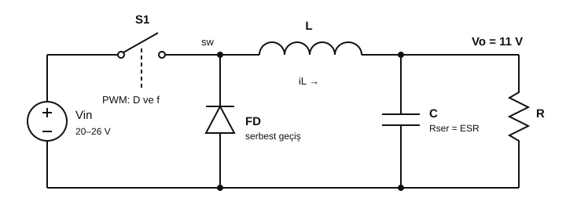

# Ayrık Buck Dönüştürücü: Proje Tanımı ve Çalışma Planı

**Tarih:** 10 Kasım 2026. **Durum:** Aşama 0, ekip ve hoca onayı bekliyor.

Bu belge projenin tek yön göstericisidir. Burada yazmayan bir şey eklenmez, sıradaki aşama onaylanmadan başlanmaz.

## 1. Proje nedir

6S LiPo bataryadan alınan 20–26 V'u 11 V'a indiren **düz bir buck dönüştürücü** tasarlıyoruz. Devreyi ders kitabındaki haliyle, tek tek elemanlardan kuruyoruz: bir anahtar, bir serbest geçiş diyotu, bir bobin, bir kapasitör ve yük.

Önceki çalışmada hazır buck entegresi (LM70880), iki faz ve çok katmanlı koruma aynı anda tasarlanmıştı. Devre hiç üretilmeden ve ölçülmeden karmaşıklaştı. Hocanın yönlendirmesi nettir: **önce yürümeyi öğrenin.** Bu yüzden proje sıfırdan başlıyor.

Amaç sadece çalışan bir kart değil, her değerin nereden geldiğini açıklayabilmektir.

## 2. Hedef ve kapsam

| Büyüklük | Değer | Kaynak |
|---|---|---|
| Giriş gerilimi | 20 V, nominal 22,2 V, en çok 26 V | 6S LiPo |
| Çıkış gerilimi | 11 V | Yük hedefi |
| Çıkış akımı | 7 A hedef, hesaplar 7,5 A ile yapılır | Önceki gereksinim, ölçülmüş yük değil |
| Topoloji | Tek faz, asenkron buck (S1 + FD + L + C) | Hocanın yönlendirmesi |
| Anahtarlama frekansı | 100 kHz | Seçim, bkz. Bölüm 5 Adım 2 |
| Bobin akım dalgalanması | Tasarım akımının %30'u | Öneri, yaygın başlangıç değeri |
| Çıkış gerilim dalgalanması | En çok 110 mV (%1) | Öneri, hoca ile netleşecek |

**Kapsam içi:** Devreyi LTspice'te tasarlamak, elle matematiksel analiz yapmak, hesap ile simülasyonu karşılaştırmak.

**Şimdilik kapsam dışı:** Hazır buck veya güç modülü entegresi, iki faz, eFuse, ters kutup koruması, aşırı gerilim mandalı, PCB. Korumalar kaldırılmadı, sadece Aşama 7'ye bırakıldı.

## 3. Devre



Devre iki durum arasında sürekli geçiş yapar:

- **S1 iletimde (D·T süresince):** Bobinin üzerinde `Vin − Vo` vardır, akımı artar, enerji depolanır. FD ters kutuplanır.
- **S1 kesimde ((1−D)·T süresince):** Bobin akımı FD üzerinden dolaşmaya devam eder. Bobinin üzerinde `−Vo` vardır, akımı azalır.

Kararlı durumda bobinin bir periyottaki ortalama gerilimi sıfırdır. Duty denkleminin tamamı buradan gelir.

## 4. Çalışma sırası

Her aşamanın sonunda kısa bir sonuç notu yazılır ve onay alınır. **Onay yoksa sonraki aşama yoktur.**

| Aşama | İş | Bitti sayılması için |
|---|---|---|
| 0 | Bu belgeyi hoca ve ekiple gözden geçirmek | Hedef ve Bölüm 7'deki sorular netleşti |
| **1** | **LTspice'te devre tasarımı, testler, matematiksel analiz** | Bölüm 6'daki testler ve karşılaştırma tamam |
| 2 | S1'in nasıl sürüleceği (MOSFET + sürücü + PWM), LTspice | Anahtar gerçek modelle doğru açılıp kapanıyor |
| 3 | Geri besleme ve yumuşak başlatma, LTspice | 20–26 V ve yük değişiminde çıkış 11 V'ta kalıyor |
| 4 | Gerçek parça seçimi, üretici verisiyle yeniden simülasyon | Her parçanın gerekçesi ve marjı yazıldı |
| 5 | KiCad şema, sonra PCB | Şema simülasyonla birebir |
| 6 | Tezgâh testi, güç direnci yükü, akım sınırlı kaynak | Ölçümler hesap ve simülasyonla karşılaştırıldı |
| 7 | Korumaları tek tek eklemek | Her koruma ayrı test edildi |

Gerçek yükler (O1, S2E) **en erken Aşama 7'den sonra** bağlanır.

## 5. Matematiksel tasarım (Aşama 1'in temeli)

Aşağıdaki sayılar başlangıç değerleridir. Güncel karar ve değerler [TASARIM-HESABI.md](TASARIM-HESABI.md) dosyasındadır (örneğin çıkış kapasitörü 2 × 680 µF oldu). Ekip her adımı elle tekrar eder. Hocanın anlattığı yöntem veya formül farklıysa hocanınki geçerlidir.

**Adım 1: Duty oranı.** Bobinde volt-saniye dengesinden:

```text
(Vin − Vo) · D · T = Vo · (1 − D) · T   →   D = Vo / Vin
```

| Vin | D (ideal) | D (kayıplı model) |
|---|---|---|
| 20 V | 0,550 | 0,577 |
| 22,2 V | 0,495 | 0,521 |
| 26 V | 0,423 | 0,446 |

Kayıplı denklem: `D = (Vo + Vf + I·DCR) / (Vin − I·Rds + Vf)`. Varsayımlar: Vf = 0,6 V, Rds = 30 mΩ, DCR = 20 mΩ.

**Adım 2: Frekans.** Frekans yükselince bobin küçülür, anahtarlama kaybı büyür. Kenar başına 60 ns geçiş süresi varsayımıyla (26 V, 7,5 A):

| f | Gereken L | Anahtarlama kaybı | En kısa iletim süresi |
|---|---|---|---|
| 50 kHz | 56,4 µH | 0,58 W | 8,46 µs |
| **100 kHz** | **28,2 µH** | **1,17 W** | **4,23 µs** |
| 200 kHz | 14,1 µH | 2,34 W | 2,12 µs |
| 400 kHz | 7,1 µH | 4,68 W | 1,06 µs |

100 kHz, elle kurulan bir sürücü için rahat, bobin boyutu ve kayıp arasında dengeli bir başlangıçtır.

**Adım 3: Bobin.** Dalgalanma en çok en yüksek girişte olur:

```text
L ≥ Vo · (1 − Dmin) / (r · Io · f)
  = 11 · (1 − 0,4231) / (0,30 · 7,5 · 100 000) = 28,2 µH   →   33 µH seçildi

ΔIL = Vo · (1 − Dmin) / (L · f) = 1,92 A
Ipk = Io + ΔIL / 2 = 8,46 A
Irms = √(Io² + ΔIL² / 12) = 7,52 A
```

Bobin toleransı −%20 ise ΔIL = 2,40 A ve Ipk = 8,70 A olur. Doyma payı için **Isat ≥ 11,3 A** (Ipk × 1,3). Yük akımı `ΔIL / 2 = 0,96 A` altına inince devre süreksiz iletime (DCM) geçer ve bu denklemler geçersiz olur.

**Adım 4: Çıkış kapasitörü.**

```text
ΔVo ≈ ΔIL / (8 · f · C) + ΔIL · ESR
```

ΔIL = 2,40 A ile 110 mV hedefinde sınırlar: kapasitif pay 11 mV için **C ≥ 273 µF**, kalan 99 mV için **ESR ≤ 41 mΩ**. Başlangıç seçimi **1000 µF, ESR 20 mΩ**, sonuç en çok 51,1 mV. Yük değişimi payı için büyük tutuldu, Aşama 3'te yeniden değerlendirilir. RMS akım 0,69 A. Gerilim sınıfı en az 25 V, anahtar kısa devresini de düşünürsek 35 V.

**Adım 5: Giriş kapasitörü.** Görseldeki devrede yoktur çünkü kaynak ideal çizilir. Gerçekte batarya kablosu nedeniyle şarttır ve Aşama 1'in kayıplı modelinde eklenir.

```text
ICin,rms = Io · √(D · (1 − D)) = 3,75 A (en kötü D ≈ 0,5)
ΔVin ≈ Io · D · (1 − D) / (f · Cin)
```

100 mV kapasitif dalgalanma için Cin ≥ 187,5 µF. Başlangıç: **2 × 220 µF, en az 50 V**, toplam RMS kapasitesi ≥ 3,75 A, yanına anahtara yakın seramik kapasitör.

**Adım 6: Anahtar ve diyot zorlanması.**

| Eleman | Gerilim | Akım | İstenen |
|---|---|---|---|
| S1 | 26 V | 8,70 A tepe, 5,56 A RMS | En az 60 V (ringing payı) |
| FD | 26 V ters | 8,70 A tepe, 4,33 A ortalama | Schottky, en az 60 V, en az 15 A |

**Adım 7: Kayıp ve verim** (26 V, 7,5 A, varsayımlarla):

| Kalem | Kayıp |
|---|---|
| FD iletimi (Vf = 0,6 V) | 2,54 W |
| Bobin DCR (20 mΩ) | 1,13 W |
| S1 anahtarlama (60 ns) | 1,17 W |
| S1 iletimi (30 mΩ) | 0,74 W |
| **Toplam** | **5,58 W, verim yaklaşık %93,7** |

Sürücü kaybı, ringing ve diyot toparlanması dahil değildir, gerçek verim daha düşük olur. En çok ısınan parça diyottur, soğutucu planlanmalıdır.

**Adım 8: LC filtresinin davranışı.**

```text
f0 = 1 / (2π√(LC)) = 876 Hz       Z0 = √(L/C) = 0,182 Ω       ζ ≈ Z0 / (2R) = 0,062
İlk açılış aşımı ≈ exp(−πζ / √(1−ζ²)) = %82   →   Vo tepe ≈ 20 V
```

Bu sonuç önemlidir: sabit duty ile aniden açılan devre çıkışta 20 V'a yakın tepe yapar. Geri besleme ve yumuşak başlatma bu yüzden ayrı bir aşamadır (Aşama 3).

## 6. Aşama 1: LTspice çalışması

**Sıra:** Önce Bölüm 5'i elle yapın. Sonra devreyi LTspice'te çizin. Sonra testleri koşup sonuçları hesapla karşılaştırın.

Başlangıç netlisti (devreyi şematikte çizerken aynı değerleri kullanın):

```spice
* Ayrik buck - ideal baslangic devresi
.param VinV=22.2 Vo=11 fs=100k Duty=Vo/VinV
.param Lval=33u Cval=1000u Rload=1.4667
V1 in 0 {VinV}
S1 in sw ctl 0 SWI
D1 0 sw DFW
L1 sw out {Lval} Rser=0
C1 out 0 {Cval} Rser=0
R1 out 0 {Rload}
V2 ctl 0 PULSE(0 5 0 5n 5n {Duty/fs-5n} {1/fs})
.model SWI SW(Ron=1m Roff=10Meg Vt=2.5 Vh=1)
.model DFW D(Ron=1m Roff=10Meg Vfwd=0)
.tran 0 50m 40m 100n
.meas tran VAVG AVG V(out)
.meas tran VMAX MAX V(out)
.meas tran VMIN MIN V(out)
.meas tran ILMAX MAX I(L1)
.meas tran ILMIN MIN I(L1)
.end
```

Referans sonuçlar, bu belge hazırlanırken LTspice'te koşuldu. Ekip kendi koşusunu yapıp karşılaştırır.

| Test | Koşul | El hesabı | LTspice referans |
|---|---|---|---|
| T1 | 22,2 V, D = 0,4955, 1,467 Ω | Vo 11, ΔIL 1,682 A | Vo 10,991 V, ΔIL 1,682 A |
| T2 | 20 V, D = 0,55 | Vo 11, ΔIL 1,500 A | Vo 10,993 V, ΔIL 1,501 A |
| T3 | 26 V, D = 0,4231 | Vo 11, ΔIL 1,923 A, Ipk 8,462 A | Vo 10,991 V, ΔIL 1,924 A, Ipk 8,456 A |
| T4 | 26 V, L = 26,4 µH, ESR 20 mΩ | ΔIL 2,404 A, ΔVo ≤ 51,1 mV | ΔIL 2,404 A, ΔVo 47,5 mV |
| T5 | D sabit 0,5, Vin 20 ve 26 V | Vo 10 ve 13 V | 9,992 V ve 12,990 V |
| T6 | Hafif yük: 22 Ω, 22,2 V | CCM denklemi geçersiz (DCM) | Vo 12,957 V, ILmin 0 |
| T7 | Sert kalkış, ideal | Vo tepe 20,05 V | Vo tepe 19,96 V, IL tepe 62,8 A |
| T7b | Sert kalkış, ESR ve DCR 20'şer mΩ | Vo tepe 17,36 V | Vo tepe 17,14 V, IL tepe 53,9 A |
| T8 | Kayıplı model, D = 0,577 / 0,521 / 0,446 | Vo 11 V | Vo 10,996 / 10,995 / 10,997 V, verim %95,3 / 95,2 / 94,9 |
| T9 | Yük 7 A'dan 0,75 A'ya düşüyor | Gözlem | 15 ms içinde 10,84 V'tan 11,94 V'a |

T8'de S1 ideal anahtar olduğu için anahtarlama kaybı yoktur. Kayıplar elle hesaba uyar: 26 V'ta 4,41 W.

**Kabul ölçütü:** T1–T5 ve T8'de Vo, ΔIL ve Ipk için hesap ile LTspice farkı %5'ten küçük olmalı. T6, T7 ve T9 geçti/kaldı testi değil, geri beslemesiz devrenin sınırlarını gösterir.

**Aşama 1'den çıkacak şunlar:** LTspice şematik dosyası, el hesabı, karşılaştırma tablosu, dalga şekli görüntüleri, kısa sonuç notu.

**Testlerin öğrettikleri:**

- Sabit duty ile çıkış girişi takip eder (T5). Batarya boşaldıkça 11 V tutmaz.
- Hafif yükte çıkış 12,96 V'a çıkar (T6). Bu, O1'in 12 V sınırının üstündedir.
- Sert kalkışta bobin akımı 50 A'yı geçer (T7), bobin doyar. Gerçek devre doğrudan bu şekilde açılmamalıdır.

## 7. Hocaya sorulacaklar

1. Hazır buck entegresi yasak, peki PWM üretecek bir entegre (TL494 gibi) veya mikrodenetleyici serbest mi?
2. MOSFET sürücü entegresi serbest mi, yoksa sürücü de transistörlerle mi kurulacak?
3. Op-amp ve karşılaştırıcı kullanılabilir mi?
4. Hedef 11 V / 7 A olarak mı kalıyor, önce daha düşük akımla mı başlayalım?
5. S1 için P-MOS mu, N-MOS mu bekleniyor? P-MOS yüksek taraf sürmeyi basitleştirir, N-MOS daha verimlidir ama kapı gerilimi girişin üstüne çıkmalıdır.
6. Hesapta izlememizi istediği özel bir yöntem veya kaynak var mı?

## 8. Çalışma kuralları (ekip ve yapay zekâ için)

1. Yalnız aktif aşama yapılır. Sonraki aşamanın işi "hazır başlamışken" yapılmaz.
2. Bir değer ancak formül, simülasyon ve karşılaştırma ile devreye girer. Gerekçesiz değer yazılmaz.
3. Hazır buck entegresi, ikinci faz veya koruma devresi, ilgili aşama gelmeden eklenmez.
4. Eski tasarımdan parça veya değer otomatik taşınmaz. Gerekirse hesapla yeniden gerekçelendirilir.
5. Hesap, varsayım, simülasyon ve ölçüm birbirinden ayrı yazılır. Simülasyon fiziksel kanıt değildir.
6. Değişiklik önerisi önce söylenir, onaydan sonra uygulanır.
7. Gerçek yük (O1, S2E), korumalar test edilmeden bağlanmaz.

## 9. Eski tasarım ne olacak

KiCad dosyaları, raporlar ve kartlar silinmez, geçmiş kayıt olarak kalır. Yeni çalışma `buck/` klasöründen ilerler. Kuyruktaki eski PCB kartları bu proje süresince işlenmez.
