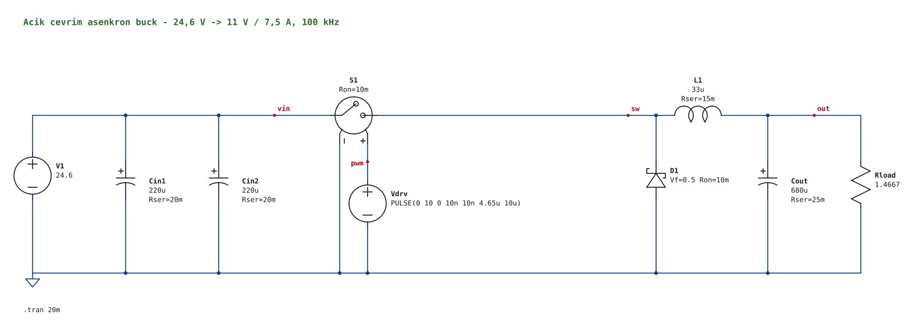

# LTspice sonuçları — açık çevrim buck ana güç katı

**Tarih:** 11 Kasım 2026 · **Araç:** LTspice 26.1.1, batch modu (`LTspice.exe -b`)
**Kapsam:** yalnız ana güç katı (kaynak, M1, D1, L1, CIN, COUT, yük, PULSE sürme). Kontrolcü, geri besleme, koruma, PCB yok.

Bu dosyada üç ayrı sınıf vardır ve karıştırılmamalıdır:

- **[S] LTspice sonucu** — bu depodaki betiklerle gerçekten koşulmuş simülasyonlardan okunan sayılar.
- **[A] Analitik hesap** — ideal buck denklemleri.
- **[V] Varsayım** — modele elle konan, ölçülmemiş/doğrulanmamış değerler.

Fiziksel ölçüm **yoktur**. Parça parametreleri LTspice kütüphane kayıtlarıdır; üretici veri sayfalarıyla **doğrulanmadı**, bu nedenle parça seçimi tamamlanmış sayılmaz.

## 1. Seçilen güç katı

| Eleman | Seçim | Modeldeki değerler (LTspice kütüphanesi) |
|---|---|---|
| fsw | 100 kHz | — |
| M1 | BSZ065N06LS5 (Infineon, 60 V) | VDMOS modeli; Ron 5,4 mΩ, Qg 10 nC |
| D1 | RBR40NS60A (Rohm, 60 V / 40 A Schottky) | Rs 5,2 mΩ, Cjo 2,33 nF, Bv 60 V |
| L1 | 33 µH, WE-HCF 74436413300 | DCR 1,33 mΩ, Rpar 1543 Ω, Cpar 18,4 pF, Ipk 36 A |
| CIN | 2 × 220 µF / 35 V polimer, WCAP-PSLC 875075661008 | ESR 11,1 mΩ, ESL 4,9 nH, Irms 4,1 A (adet başı) |
| COUT | 1 × 330 µF / 25 V polimer, WCAP-PTG5 870025575009 | ESR 9,2 mΩ, ESL 5,9 nH, Irms 4,9 A |
| Kapı sürme | PULSE 0–10 V, tr = tf = 10 ns, Rg = 10 Ω | [V] ideal sürücü |
| Yük | 1,4667 Ω | 11 V / 7,5 A |



Şematik: [buck_guc_kati.asc](buck_guc_kati.asc) (LTspice'ta açılır; netlist'e çevrilip batch modda koşuldu: Vo = 11,003 V, verim %97,47, 22,2 V girişte).
Parazitik doğrulama netlist'i: [buck_guc_kati_parazitik.cir](buck_guc_kati_parazitik.cir).

**Fiziksel gerçekleme için gereken ekler** (yalnız parazitik modelde var, bkz. §5): girişte ve çıkışta anahtara yakın 2 × 10 µF MLCC ve D1 üzerinde 2,2 Ω + 1 nF RC sönümleyici. RC sönümleyici `CLAUDE.md`'deki eleman listesinde yoktur; ana şematiğe eklenmedi, karar kullanıcıya bırakıldı.

### Duty (11,00 V için LTspice ile ayarlandı — fiziksel geri besleme değildir)

| Vin | [A] ideal D = Vo/Vin | [S] ayarlı D (hızlı model) | [S] ayarlı D (parazitik model) |
|---:|---:|---:|---:|
| 20 V | 0,5500 | 0,5612 | 0,5615 |
| 22,2 V | 0,4955 | 0,5058 | 0,5060 |
| 26 V | 0,4231 | 0,4320 | 0,4322 |

## 2. Modeller ve varsayımlar [V]

- Kaynak: ideal DC + Rsrc = 20 mΩ + Lsrc = 300 nH (batarya + kablo). Verim, dönüştürücü giriş ucunda (`vin` düğümü) ölçülür: η = Pout / (Pin + Pgate).
- **Hızlı model:** ESR ve DCR var; ESL ve sıcak çevrim endüktansı yok. Taramalar ve hat/yük/tolerans koşuları bununla yapıldı.
- **Parazitik model:** kondansatör ESL'leri, bulk–MLCC arası 5 nH, MLCC–M1–D1 sıcak çevrimi 3 nH (MLCC yokken tek 5 nH), MLCC etkin değeri 4,7 µF (giriş, 26 V ön gerilim) ve 8 µF (çıkış), ESR 3 mΩ, ESL 0,8 nH. Bu endüktanslar yerleşim tahminidir.
- Zaman adımı üst sınırı 20 ns. LTspice'ın varsayılan adımı MOSFET kaybını yanlış veriyordu (0,31 W yerine 0,22 W); 5 ns ile karşılaştırıldığında 20 ns'de verim farkı < 0,01 puan.
- Çıkış ripple'ı iki şekilde verilir: tam bant ve 20 MHz bant sınırlı (osiloskop BW-limit eşdeğeri).
- Bobin çekirdek kaybı yalnız kütüphanedeki sabit `Rpar` ile temsil edilir; frekansa/akıya bağlı gerçek çekirdek kaybı **modellenmedi**. Bu yüzden frekans karşılaştırması bobin kaybı açısından iyimserdir.
- MOSFET modeli (VDMOS) çığ kırılmasını ve kendi kendine ısınmayı modellemez. Sıcaklık koşuları `.temp` ile yapıldı; eklem sıcaklığı hesabı yapılmadı.
- Paralel LTspice süreçleri rastlantısal olarak takılabildi (aynı netlist tek başına < 1 s). Betik zaman aşımıyla aynı netlist'i yeniden koşar; hiçbir sonuç çözücü değiştirilerek alınmadı.

## 3. Karşılaştırmalar [S]

Hepsi 11 V / 7,5 A sabit çıkışta, duty her noktada yeniden ayarlanarak. Ham veriler `sonuc/` altında.

### 3.1 Frekans × bobin (141 koşu, [tarama1_f_L.txt](sonuc/tarama1_f_L.txt))

M1 = BSZ065N06LS5, D1 = RB228NS-60, Rg = 4,7 Ω ile:

| f / L | η @20 V | η @22,2 V | η @26 V | Vo ripple 20 MHz @26 V |
|---|---:|---:|---:|---:|
| 50 kHz / 68 µH (AGP4233-683) | 97,06 | 96,77 | 96,40 | 21 mV |
| 100 kHz / 33 µH (WE-HCF) | 97,05 | 96,75 | 96,34 | 20 mV |
| 100 kHz / 33 µH (AGP4233-333, 2,8 mΩ) | 97,01 | 96,71 | 96,31 | 20 mV |
| 200 kHz / 15 µH (WE-HCF) | 96,96 | 96,65 | 96,22 | 24 mV |
| 400 kHz / 10 µH (WE-HCF) | 96,81 | 96,48 | 96,02 | 19 mV |
| 100 kHz / 39 µH (Bourns SRP1770TA, 40 mΩ) | 94,75 | 94,47 | 94,09 | 17 mV |

Sonuç: 50–200 kHz arasında verim farkı yalnız ~0,1 puandır; bobin DCR'si çok daha belirleyicidir (40 mΩ'luk 39 µH bobin 2,3 puan kaybettirir). 100 kHz / 33 µH, ripple (~%25) ve parça boyutu dengesi için seçildi; 50 kHz'in 0,02 puanlık kazancı iki kat endüktansı haklı çıkarmıyor.

### 3.2 MOSFET × diyot (216 koşu, [tarama2_mos_diyot.txt](sonuc/tarama2_mos_diyot.txt))

Kaybın ~%75–80'i serbest geçiş diyodundadır; asıl kazanç diyottan gelir.

| M1 | D1 | η @20 V | η @22,2 V | η @26 V | Not |
|---|---|---:|---:|---:|---|
| BSC059N04LS6 (40 V) | RBQ30NS45B (45 V) | 97,89 | 97,67 | 97,38 | en yüksek verim; gerilim payı yetersiz |
| BSZ065N06LS5 (60 V) | RBQ30NS45B (45 V) | 97,80 | 97,60 | 97,31 | D1 parazitik modelde kırılmaya giriyor |
| **BSZ065N06LS5 (60 V)** | **RBR40NS60A (60 V)** | **97,71** | **97,50** | **97,19** | **seçilen** |
| BSZ065N06LS5 (60 V) | RB228NS-60 (60 V) | 97,05 | 96,75 | 96,34 | başlangıç adayı |

45 V'luk RBQ30NS45B 0,1 puan daha verimlidir ama büyük eklem kapasitansı (4,8 nF) yüzünden parazitik modelde sönümleyiciyle bile 45,3 V'a (Bv = 45 V) çıkıyor; bu yüzden elendi. 40 V MOSFET'ler 26 V giriş + zil için dar bulundu.

### 3.3 Kondansatörler ([dogrulama_A.txt](sonuc/dogrulama_A.txt), L ve C −%20, ESR ×1,5 köşesi)

- CIN 1 × 220 µF: giriş ripple'ı 379–426 mV ve tek kondansatör 3,86 A RMS taşır (derecesi 4,1 A) → yetersiz. 2 × 220 µF: 191–215 mV, adet başı ~1,9 A.
- COUT 100 µF: 50 mV (55 mV sınırına çok yakın); 330 µF: 28–35 mV. 330 µF seçildi.

## 4. Nihai tasarımın doğrulaması [S] ([nihai_dogrulama.txt](sonuc/nihai_dogrulama.txt))

### 4.1 Hat × yük, duty 11 V'a ayarlı (hızlı model)

| Vin | Yük | η | Toplam kayıp | P_M1 | P_D1 | P_L1 | IL min/maks | Vo ripple (20 MHz) | Vin ripple |
|---:|---:|---:|---:|---:|---:|---:|---:|---:|---:|
| 20 V | %25 | %97,91 | 0,44 W | 0,05 | 0,30 | 0,07 | 0,97 / 2,73 A | 14,6 mV | 58 mV |
| 20 V | %100 | %97,67 | 1,97 W | 0,27 | 1,44 | 0,14 | 6,65 / 8,31 A | 14,3 mV | 95 mV |
| 20 V | %120 | %97,56 | 2,48 W | 0,37 | 1,78 | 0,17 | 8,14 / 9,80 A | 14,1 mV | 107 mV |
| 22,2 V | %25 | %97,64 | 0,50 W | 0,05 | 0,33 | 0,09 | 0,83 / 2,90 A | 16,3 mV | 60 mV |
| 22,2 V | %50 | %97,69 | 0,98 W | 0,10 | 0,73 | 0,10 | 2,75 / 4,71 A | 16,3 mV | 72 mV |
| 22,2 V | %100 | %97,45 | 2,16 W | 0,27 | 1,62 | 0,16 | 6,54 / 8,42 A | 16,0 mV | 98 mV |
| 22,2 V | %120 | %97,33 | 2,71 W | 0,36 | 2,01 | 0,19 | 8,03 / 9,91 A | 16,0 mV | 109 mV |
| 26 V | %25 | %97,26 | 0,58 W | 0,06 | 0,38 | 0,12 | 0,69 / 3,02 A | 18,5 mV | 64 mV |
| 26 V | %100 | %97,14 | 2,43 W | 0,26 | 1,87 | 0,19 | 6,39 / 8,49 A | 18,9 mV | 100 mV |
| 26 V | %120 | %97,03 | 3,03 W | 0,35 | 2,32 | 0,22 | 7,89 / 10,04 A | 18,3 mV | 109 mV |

Tüm noktalarda çıkış 11,000 V ± 1,6 mV ve ardışık iki 1 ms pencere arasındaki fark ≤ 0,3 mV (kararlı durum). **İstisna:** 22,2 V / %10 yük noktası CCM–DCM sınırındadır (IL min −0,07 A); burada Vo–duty eğrisi kırıktır ve duty ayarı 14 yinelemede ±2 mV ölçütüne giremedi. En iyi nokta D = 0,4581, Vo = 11,011 V (+11 mV), η = %97,32, kayıp 0,23 W. Bu nokta yaklaşık sonuçtur.

[A] ile karşılaştırma: ideal ΔIL (33 µH, 100 kHz) 20 / 22,2 / 26 V için 1,50 / 1,68 / 1,92 A; [S] 1,66 / 1,88 / 2,10 A. Fark, L1'in `Cpar`'ından geçen kenar iğnelerinin `I(L1)` ölçümüne eklenmesinden kaynaklanır.

### 4.2 Tolerans köşeleri (tam yük)

| Köşe | Vin | η | IL maks | Vo ripple (20 MHz) | Vin ripple | ICIN / ICOUT RMS |
|---|---:|---:|---:|---:|---:|---:|
| nominal | 26 V | %97,14 | 8,49 A | 18,9 mV | 100 mV | 3,79 / 0,56 A |
| L −%20 | 26 V | %97,13 | 8,81 A | 22,9 mV | 98 mV | 3,80 / 0,70 A |
| C −%20, ESR ×1,5 | 26 V | %97,09 | 8,49 A | 27,2 mV | 148 mV | 3,80 / 0,56 A |
| L −%20, C −%20, ESR ×1,5, DCR ×1,3 | 26 V | %97,06 | 8,81 A | 34,0 mV | 149 mV | 3,81 / 0,70 A |
| aynı | 20 V | %97,60 | 8,50 A | 26,2 mV | 140 mV | 3,80 / 0,54 A |

En kötü köşede çıkış ripple'ı 34 mV (< 55 mV), giriş ripple'ı 149 mV (< 200 mV).

### 4.3 Sıcaklık (`.temp`, 22,2 V, tam yük)

| T | η | P_M1 | P_D1 |
|---:|---:|---:|---:|
| 27 °C | %97,45 | 0,27 W | 1,62 W |
| 85 °C | %97,58 | 0,28 W | 1,50 W |
| 125 °C | %96,99 | 0,29 W | 2,00 W |

125 °C'de diyot kaybı artar (ters kaçak). Bu yalnız modelin sıcaklık davranışıdır; termal direnç/soğutma hesabı yapılmadı.

### 4.4 Sabit duty (açık çevrim davranışı), D = 0,5058

| Vin | Yük | Vo |
|---:|---:|---:|
| 20 V | %100 | 9,89 V |
| 22,2 V | %100 | 11,00 V |
| 26 V | %100 | 12,91 V |
| 22,2 V | %50 | 11,07 V |
| 22,2 V | %10 | 11,27 V |
| 26 V | %10 | 13,22 V |

Sabit duty ile 12 V üst sınırı 26 V girişte aşılır. Açık çevrim regülasyon sağlamaz.

### 4.5 Parazitik model (giriş/çıkış MLCC, Rg = 10 Ω, RC 2,2 Ω + 1 nF), tam yük

| Vin | η | Vds maks (M1) | Ters gerilim maks (D1) | Vo ripple tam bant / 20 MHz | Id tepe (M1) |
|---:|---:|---:|---:|---:|---:|
| 20 V | %97,61 | 25,8 V | 30,2 V | 163 / 20,6 mV | 16,9 A |
| 22,2 V | %97,39 | 27,5 V | 33,0 V | 189 / 23,1 mV | 17,6 A |
| 26 V | %97,07 | 30,2 V | 37,8 V | 235 / 26,3 mV | 18,9 A |

60 V'luk parçalarda zorlanma: M1 %50, D1 %63. Hızlı modelle verim farkı ≤ 0,07 puan.

### 4.6 Sıfırdan sert kalkış (soft-start yok, hızlı model, L1 doğrusal)

| Vin | IL tepe | Vo tepe | Giriş akımı tepe |
|---:|---:|---:|---:|
| 20 V | 35,4 A | 17,89 V | 20,6 A |
| 22,2 V | 35,6 A | 17,93 V | 18,7 A |
| 26 V | 35,8 A | 17,97 V | 16,0 A |

Tepe bobin akımı kütüphanedeki Ipk = 36 A değerine dayanıyor ve çıkış ~18 V'a aşıyor. Model bobin doyumunu içermez; gerçek akım daha yüksek olabilir. Bu güç katı duty rampası (soft-start) olmadan **gerçek yüke bağlanamaz**; soft-start bu çalışmanın kapsamı dışındadır.

## 5. Yapılan optimizasyonlar

1. **Diyot:** RB228NS-60 → RBR40NS60A ile 22,2 V'ta +0,75 puan (P_D1 2,27 → 1,63 W).
2. **Bobin:** düşük DCR'li 33 µH; repo adayı 39 µH için kütüphanedeki tek ≥ 11 A parça (40 mΩ) 2,3 puan kaybettiriyordu.
3. **Frekans:** 100 kHz korundu; taramada daha yüksek frekansın kazancı yok, daha düşüğün kazancı ihmal edilebilir.
4. **Zil/aşım (en önemli bulgu):** hızlı modelde görünmeyen bir sorun parazitik modelde ortaya çıktı. Rg = 4,7 Ω ve yalnız polimer kondansatörlerle D1 ters gerilimi 60,7 V'a (Bv = 60 V), Vds 48 V'a çıkıyordu ([dogrulama_A.txt](sonuc/dogrulama_A.txt)). Yalnız Rg büyütmek yetmedi: 38 V'a inmek için Rg = 47 Ω gerekti ve verim 0,5 puan düştü ([dogrulama_D_zil.txt](sonuc/dogrulama_D_zil.txt)). MLCC + Rg = 10 Ω + 2,2 Ω/1 nF sönümleyici aynı sonucu 0,1 puandan az kayıpla verdi ([dogrulama_E_snubber.txt](sonuc/dogrulama_E_snubber.txt)): D1 60,7 → 37,8 V, Vds 48,1 → 30,2 V, 20 MHz çıkış ripple'ı 223 → 26 mV.
5. **Kondansatörler:** CIN 2 × 220 µF (ripple akımı paylaşımı), COUT 330 µF (tolerans köşesinde 34 mV).

Repo'daki analitik hesaplar ([TASARIM-HESABI.md](../TASARIM-HESABI.md)) bağımsız olarak yeniden hesaplandı ve denklemler/sayılar tutarlı bulundu. Fark: oradaki ESR varsayımları (15/20 mΩ) seçilen polimer parçaların kütüphane değerlerinden (5,6 mΩ eşdeğer / 9,2 mΩ) kötümserdir.

## 6. Dalga şekilleri ([dalga_sekilleri/](dalga_sekilleri/))

- `kararli_durum_26V_tam_parazitik.svg` — V(sw), Vds, I(L1), V(out), Id(M1), I(D1); son 25 µs. Ham veri: aynı adlı `.npz`.
- `acma_kenari_26V_tam_parazitik.svg` — M1 açma kenarı yakın planı (ns ölçeği).
- `sert_kalkis_20p0V.svg`, `sert_kalkis_22p2V.svg`, `sert_kalkis_26p0V.svg` — sıfırdan kalkış.

## 7. Değerlendirme ve açık kalanlar

Simülasyonda güç katı 20–26 V girişte 11 V / 7,5 A'yı %97,1–97,7 verimle (parazitik modelde %97,1–97,6) veriyor; ripple ve gerilim zorlanmaları hedeflerin içinde. Aşağıdakiler **doğrulanmadı**:

- Parça verileri üretici veri sayfalarıyla karşılaştırılmadı (Ron/Vf sıcaklık eğrileri, Isat, ripple akımı dereceleri, kılıf/termal).
- Bobin çekirdek kaybı ve doyumu; MOSFET/diyot eklem sıcaklıkları; gerçek sürücünün kenar hızları.
- Yerleşim endüktansları tahmindir; sönümleyici değerleri gerçek kartta ölçümle ayarlanmalıdır.
- %10 yük noktası (DCM sınırı) ±2 mV ölçütüne yakınsamadı; sonuç +11 mV sapmalıdır.
- Sert kalkış kabul edilemez (18 V aşım, ~36 A); soft-start olmadan fiziksel kullanım yok.
- LTspice MCP sunucusu bu oturumda bağlı değildi (kayıtlı süreç kapalıydı); tüm koşular LTspice batch moduyla yapıldı.

## 8. Yeniden üretim

```text
python tarama1_f_L.py
python tarama2_mos_diyot.py 100 "WE-HCF 74436413300 33u"
python dogrulama_A.py ; python dogrulama_D_zil.py ; python dogrulama_E_snubber.py
python nihai_dogrulama.py
python sematik_uret.py 0.5058 0.5612 0.4320   # .asc ve .svg birlikte üretilir
python asc_gorsel.py                           # .asc elle değiştirildiyse yalnız görseli yeniler
```

`araclar.py` netlist üretir, LTspice'ı koşar, `.meas` sonuçlarını okur ve duty'yi ayarlar. `calisma/` geçici çalışma klasörüdür.
